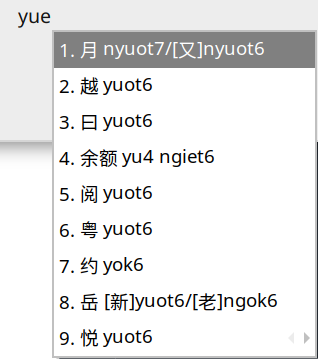
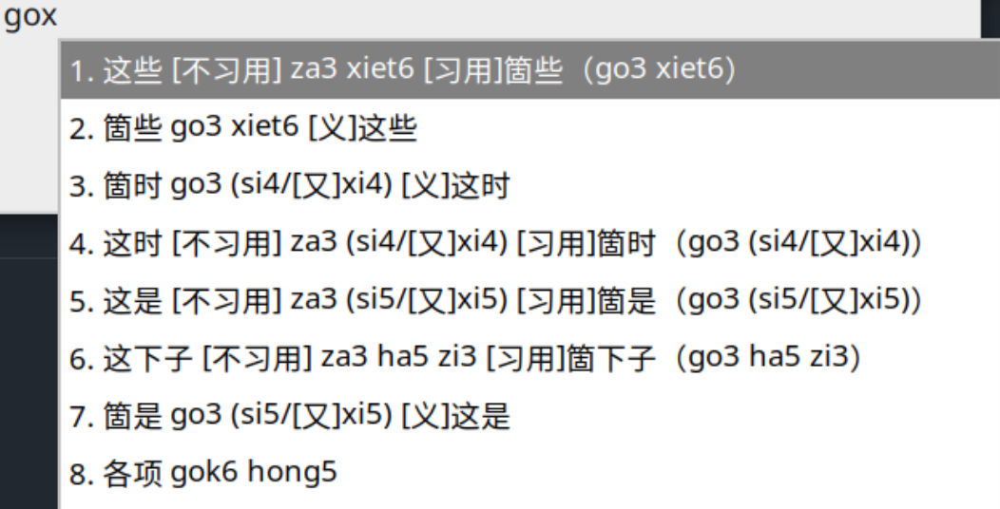
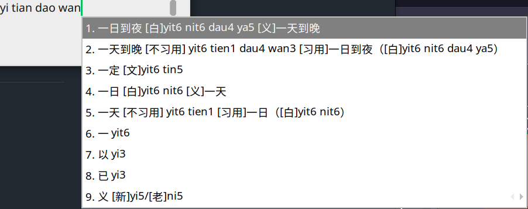
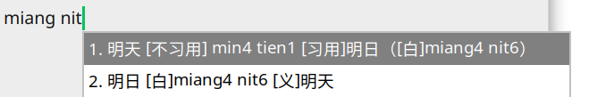
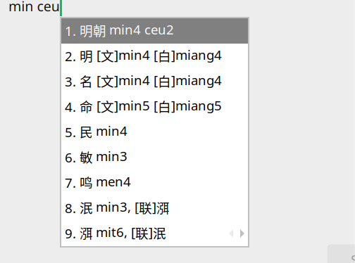
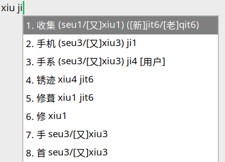

# GonnyuGeneralIME — A General Gon(Gan) Chinese Input Method | GonPin

[简体中文](README.md) | **English**

> A digital writing system rooted in the Gon(Gan)–Poyang region.

Currently supports: **Lancong (Nanchang), Fenni (Fenyi), Fungcen (Fengcheng), Tiqien (Lichuan), Sinyi (Xinyu City), Songau (Shanggao), Seusong (Susong), Jingon (Ji'an), Yikyan-Henfeng (Yiyang and Hengfeng), Jisuibaedu (Jishuibadou), Xyucuênn (Suichuan), Singzï (Xingzi), and Goungon (Goungon)**. Contributions are welcome for additional localities and additions to existing regional dictionaries.

[](CONTRIBUTION.md)

**An easy-to-install Gon(Gan) input method for everyday use. Users familiar with Pinyin can get started with compatible support for Gon(Gan) romanisation and Mandarin Pinyin. Even users who do not speak Gon(Gan) can explore it, and Gon(Gan) expressions can also be used to write extended passages in Mandarin, including text like this document.**

**Now available on the iOS App Store as 赣语输入法. Native installation is available on macOS, Android, Windows, and Linux, alongside Rime resource packages.**

[](https://github.com/Doohaey/GonnyuGeneralIME-Rime-Lancong)
[](https://github.com/Doohaey/GonnyuGeneralIME-Rime-Fenni)
[](https://github.com/Doohaey/GonnyuGeneralIME-Rime-Fungcen)
[](https://github.com/Doohaey/GonnyuGeneralIME-Rime-Yikyan-Henfeng)
[](https://github.com/Doohaey/GonnyuGeneralIME-Rime-Sinyi)
[](https://github.com/Doohaey/GonnyuGeneralIME-Rime-Goungon)

Rime schema repositories are available for Lancong (Nanchang), Fenni (Fenyi), Fungcen, Yikyan-Henfeng, Sinyi (Xinyu), and Goungon (Gao'an). Other installation options are available in the [Installation](#installation) section below.

## Release 1.3.1

- data: Add entries to the Lancong dictionary.
- fix: Fix the Second Scheme medial spelling.

## Contents

- [GonnyuGeneralIME — A General Gon(Gan) Chinese Input Method](#gonnyugeneralime--a-general-gongan-chinese-input-method)
  - [Release 1.3.1](#release-131)
  - [Contents](#contents)
  - [Overview](#overview)
    - [What it provides](#what-it-provides)
  - [See Gan in action](#see-gan-in-action)
    - [No learning needed, type by instinct](#no-learning-needed-type-by-instinct)
    - [Broad vocabulary, local life in full, rare characters no longer a barrier](#broad-vocabulary-local-life-in-full-rare-characters-no-longer-a-barrier)
    - [Gan and Mandarin, side by side](#gan-and-mandarin-side-by-side)
    - [Mandarin Pinyin, straight to Gan](#mandarin-pinyin-straight-to-gan)
    - [Literary or colloquial — clear at a glance](#literary-or-colloquial--clear-at-a-glance)
    - [Every Gan reading welcome, old and new](#every-gan-reading-welcome-old-and-new)
  - [Installation](#installation)
    - [macOS](#macos)
    - [iOS](#ios)
    - [Android](#android)
    - [Windows](#windows)
    - [Linux Fcitx5](#linux-fcitx5)
    - [Rime](#rime)
    - [Input settings](#input-settings)
  - [The General Gon-pin Romanisation](#the-general-gon-pin-romanisation)
    - [First scheme (Han-Pinyin style)](#first-scheme-han-pinyin-style)
      - [Initials](#initials)
        - [Initial segments](#initial-segments)
      - [Finals](#finals)
        - [Final segments](#final-segments)
        - [Open finals](#open-finals)
        - [Front-vowel finals](#front-vowel-finals)
        - [Rounded finals](#rounded-finals)
        - [Rounded front-vowel finals](#rounded-front-vowel-finals)
        - [Syllabic laterals and nasals](#syllabic-laterals-and-nasals)
      - [Tones](#tones)
        - [Lancong (Nanchang)](#lancong-nanchang)
        - [Fungcen (Fengcheng)](#fungcen-fengcheng)
        - [Tiqien (Lichuan)](#tiqien-lichuan)
        - [Sinyi (Xinyu City)](#sinyi-xinyu-city)
        - [Songau (Shanggao)](#songau-shanggao)
        - [Seusong (Susong)](#seusong-susong)
        - [Jingon (Jian City)](#jingon-jian-city)
        - [Yikyan-Henfeng (Yiyang-Hengfeng)](#yikyan-henfeng-yiyang-hengfeng)
        - [Jisuibaedu (Jishuibadou)](#jisuibaedu-jishuibadou)
        - [Xyucuênn (Suichuan)](#xyucuênn-suichuan)
        - [Singzï (Xingzi)](#singzï-xingzi)
        - [Goungon (Goungon)](#goungon-goungon)
    - [Second scheme (Compositional)](#second-scheme-compositional)
    - [Other notes](#other-notes)
  - [References](#references)
    - [Literature](#literature)
    - [Reference implementations](#reference-implementations)
    - [Dependency declarations](#dependency-declarations)
    - [Licensing and rights reservation](#licensing-and-rights-reservation)
    - [Acknowledgements](#acknowledgements)
  - [Contributors and contact](#contributors-and-contact)

## Overview

In the second half of 2025, we began thinking about creating a general Gon(Gan) input method, after observing input methods for other Sinitic languages. We initially assembled a basic dictionary by drawing on several sources to organise the correspondences between Gon(Gan) pronunciation and Chinese characters. We soon felt that simple sound-to-character mappings were insufficient for our needs. We wanted a more systematic way to organise and preserve language materials from different Gon(Gan)-speaking localities. The resulting project supports typing characters by their Gon(Gan) pronunciation, writing Mandarin through Gon(Gan) expressions, and producing idiomatic Gon(Gan) text even for younger people who have heard the language but are not proficient in it, or enthusiasts interested in Gon(Gan).

“General” has three meanings: use across Gon(Gan) localities, use across Gon(Gan) and Mandarin, and technical support across platforms.

Our project favours etymologically supported and standard character forms while accommodating common vernacular spellings, helping users write local Chinese that combines standard usage with familiar forms.

### What it provides

Beyond the dictionaries themselves, the input method currently provides:

- Pronunciation annotations for characters and words. The spelling system and tone notation are described below. It stays close to Hanyu Pinyin where possible to reduce the learning curve.
- Tolerant input for spelling habits familiar to Mandarin-input users, while presenting results in the project’s own spelling.
- Cross-references between common Mandarin words and local Gon(Gan) vocabulary. When either side is found, the corresponding expression is also offered as a candidate.
- Compatible input and clear annotation for literary and colloquial readings, newer and older readings, and other alternate pronunciations.

The project currently maintains 13 regional dictionaries: urban Lancong (Nanchang), Fenni (Fenyi County in Xinyu), Fungcen, Tiqien (Lichuan), Sinyi (Xinyu City), Songau (Shanggao), Seusong (Susong), Jingon (Jian City), Yikyan-Henfeng (Yiyang-Hengfeng), Jisuibaedu (Jishuibadou), Xyucuênn (Suichuan), Singzï (Xingzi), and Goungon (Goungon). We hope to expand substantially to other localities as well. Contributions to add and correct dictionary entries are welcome.

## See Gan in action

<sub>The examples below use Nanchang Gan.</sub>

### No learning needed, type by instinct

Know Mandarin Pinyin and start typing right away. Enter a familiar Pinyin spelling, and the input method finds the corresponding Gan reading without requiring a separate input scheme.



### Broad vocabulary, local life in full, rare characters no longer a barrier

Over 20,000 Chinese characters, including extensive coverage of Unicode Extension B with theoretical readings derived from rhyme dictionaries; over 100,000 words; abundant idiomatic local expressions; and distinctive pronunciations for place names. The dictionary goes far beyond a bare list of character readings.


### Gan and Mandarin, side by side

Type in Gan and see related Mandarin words at the same time. Recognise, confirm, and choose the word you want in one glance.



### Mandarin Pinyin, straight to Gan

Have the Mandarin word in mind first? Type its familiar Pinyin and find the Gan expression right away.



### Literary or colloquial — clear at a glance

Literary and colloquial layers, clearly shown.





### Every Gan reading welcome, old and new

Alternate Gan pronunciations, including older and newer patterns, are all ready for input and lookup. Type the Gan you know, your way.




## Installation

The native input method is available for Linux, Android, Windows, and macOS. Installation of the universal Rime resource packages is described in the Rime section.

Packages for each operating system or locality are available from [Releases](https://github.com/Doohaey/GonnyuGeneralIME/releases).

### macOS

Download `GonnyuGeneralIME-version-macos.pkg` from [Releases](https://github.com/Doohaey/GonnyuGeneralIME/releases), open it, and complete the installation.

If it does not appear automatically, open **System Settings → Keyboard → Text Input → Edit…**, click **+**, search for and add **Gonnyu**, then select it from the input menu. Upgrades preserve the user dictionary.

If the input method is absent from the list in System Settings or cannot be selected after being added, signing out and back in may resolve the issue.

### iOS

iOS users can download **赣语输入法** from the App Store, except in the France storefront.

### Android

Download `GonnyuGeneralIME-version-android.apk` and open it on Android to install. On first launch, follow the in-app setup to enable the Gon(Gan) Chinese input method, then select it from the system input-method picker.

### Windows

Download and run `GonnyuGeneralIME-version-windows-installer.exe`. After the installer finishes, open **Settings → Time & language → Language & region → Chinese (Simplified) → Keyboards** and add **Gannyu**.

### Linux Fcitx5

Each scheme ships separately: download `GonnyuGeneralIME-version-fcitx5-gonnyu.tar.gz` for the first scheme or `GonnyuGeneralIME-version-fcitx5-gonnyu_II.tar.gz` for the second. Extract the archive and run the installer included in it:

```sh
mkdir GonnyuGeneralIME-fcitx5
tar -xzf GonnyuGeneralIME-version-fcitx5-gonnyu.tar.gz -C GonnyuGeneralIME-fcitx5
cd GonnyuGeneralIME-fcitx5
./install.sh
```

Restart Fcitx5 with `fcitx5 -r`, or sign out and back in. Then add **GonnyuGeneralIME / 赣语（一式）** or **GonnyuGeneralIME (Compositional) / 赣语（二式）** in `fcitx5-configtool`.

### Rime

Each locality provides two independent packages:

- `GonnyuGeneralIME-version-rime-region.zip`: First scheme (Han-Pinyin style)
- `GonnyuGeneralIME-version-rime-region-II.zip`: Second scheme (Compositional)

Download only the package you need. To use both schemes, install both packages into the same Rime user directory.

**Windows Weasel**

1. Download the required ZIP.
2. Extract it into `%APPDATA%\Rime`.
3. Choose **Redeploy** from the input-method menu.
4. Select the locality in the first or second scheme from the schema menu.

**Linux Fcitx5 Rime**

1. Download the required ZIP.
2. Extract it into `~/.local/share/fcitx5/rime/`.
3. Redeploy Rime.
4. Select the required scheme from the schema menu.

**iOS and Android**

Import or deploy the required ZIP in your Rime front end, then select the scheme from the schema menu.

If both packages are installed, keep both schemas in the `default.custom.yaml` schema list.

### Input settings

All switches are enabled by default, with both newer and older readings selected. Changes take effect without reinstalling or redeploying.

| Setting | Effect |
| --- | --- |
| Annotations | Show or hide candidate readings and annotations. |
| Gan–Mandarin associations | Control associated Gan and Mandarin candidates and their annotations. Disabling this filters Mandarin words while retaining single-character candidates. |
| Synonym associations | Control associated synonym candidates and their annotations, independently of Gan–Mandarin associations and annotations. |
| Fuzzy matching | Master switch for Mandarin Pinyin compatibility, literary–colloquial matching, and other fuzzy rules. Mandarin Pinyin compatibility allows words to be found using Mandarin Pinyin. Literary–colloquial matching links literary and colloquial readings; disabling it preserves their labels. Other fuzzy rules control matching beyond compatibility for the special i, e, and o phonemes (ï, ê, ô). |
| Reading mode | Select both newer and older readings, newer readings, or older readings. This affects matching and the readings shown in annotations. |
| Scheme | Select the first scheme (Han-Pinyin style) or the second scheme (Compositional). Localities without the second scheme offer the first scheme only. |

Disabling fuzzy matching suspends its three child options while preserving their selections; these options appear greyed out on mobile.

| Platform | Access |
| --- | --- |
| macOS | Click **赣·locality** in the menu bar and open **输入设置**. |
| Windows | With the Gan input method active, open **输入设置** in the language bar. |
| iOS, Android | Open the Gan input method app and adjust **输入设置**. |
| Rime | Open the front end’s schema menu and select a switch or reading mode. |
| Native Linux Fcitx5 | Install the `gonnyu` (first scheme, Han-Pinyin style) or `gonnyu_II` (second scheme, Compositional) input method; there is no runtime scheme switch. |

## The General Gon-pin Romanisation

The system aims to cover phonemes across localities, represents necessary phonemic contrasts, and provides consistent notation for nasalised finals and voiced consonants in some Gon(Gan) varieties. To accommodate mergers in newer varieties and facilitate input, it does not attempt to transcribe every phonetic detail, such as breathy or slack phonation, and merges sound values that are not contrastive within a locality or occur as alternative pronunciations.

The input method provides two parallel schemes: the first scheme (Han-Pinyin style) and the second scheme (Compositional). They can be switched in Input settings.

### First scheme (Han-Pinyin style)

The general Gon(Gan) romanisation (gon-pin) first scheme used by this project represents Gon(Gan) pronunciation while keeping its spellings as close as practical to Hanyu Pinyin for everyday input.

#### Initials

| gon-pin | Lancong IPA | Fungcen IPA | Tiqien IPA | Sinyi IPA | Songau IPA | Seusong IPA | Jingon IPA | Yikyan-Henfeng IPA | Jisuibaedu IPA | Xyucuênn IPA | Singzï IPA | Goungon IPA | Accepted alternative input | Notes |
| --- | --- | --- | ------- | ------- | ------- | ------- | ------- | ------- | ------- | ------- | ------- | ------- | --- | --- |
| ∅ | [] or [ʔ] | - | - | - | - | - | - | - | - | - | - | - |  | Zero initial, with [ʔ] as a special case. |
| b | [p] | [p] | [p] | [p] | [p] | [p] | [p] | [p] | [p] | [p] | [p] | [p] |  |  |
| p | [pʰ] | [pʰ] | [pʰ] | [pʰ] | [pʰ] | [pʰ] | [pʰ] | [pʰ] | [pʰ] | [pʰ] | - | [pʰ] |  |  |
| m | [m] | [m] | [m] | [m] | [m] | [m] | [m] | [m] | [m] | [m] | [m] | [m] | - |  |
| f | [ɸ] or [f] | [f] | [f] | [ɸ] or [f] | [f] | [f] | [f] | [f] | [f] | [f] | [f] | [f] | — | Usually transcribed as [f]; some consider it closer to [ɸ], a bilabial sound. |
| d | [t] | [t] | [t] | [t] | [t] | [t] | [t] | [t] | [t] | [t] | [t] | [t] |  |  |
| t | [tʰ] | [tʰ] | [tʰ] | [tʰ] | [tʰ] | [tʰ] | [tʰ] | [tʰ] | [tʰ] | [tʰ] | - | [tʰ] |  |  |
| l | [l] | [l] | [l] | [l] | [l] | [l] | [l] | [l] | [l] | [l] | [l] | [l] | - |  |
| z | [ts] | [ts] | [ts] | [ts] | [ts] | [ts] | [ts] | [ts] | [ts] | [ts] | [ts] | [ts] |  |  |
| c | [tsʰ] | [tsʰ] | [tsʰ] | [tsʰ] | [tsʰ] | [tsʰ] | [tsʰ] | [tsʰ] | [tsʰ] | [tsʰ] | - | [tsʰ] |  |  |
| s | [s] | [s] | [s] | [s] | [s] | [s] | [s] | [s] | [s] | [s] | [s] | [s] |  |  |
| j | [tɕ] | [tɕ] | [tɕ] | [tɕ] | [tɕ] | [tɕ] | [tɕ] | [tɕ] | [tɕ] | [tɕ] | [tɕ] | [tɕ] |  |  |
| q | [tɕʰ] | [tɕʰ] | [tɕʰ] | [tɕʰ] | [tɕʰ] | [tɕʰ] | [tɕʰ] | [tɕʰ] | [tɕʰ] | [tɕʰ] | - | [tɕʰ] |  |  |
| n | [ȵ] | [ȵ] | [n] | [ȵ] | [ȵ] | [n] or [ɳ] or [ȵ] | [ȵ] | [n] or [ȵ] | [ɳ] | [n] or [ȵ] | [n] or [ȵ] | - | - |  |
| x | [ɕ] | [ɕ] | [ɕ] | [ɕ] | [ɕ] | [ɕ] | [ɕ] | [ɕ] | [ɕ] | [ɕ] | [ɕ] | [ɕ] |  |  |
| g | [k] | [k] | [k] | [k] | [k] | [k] | [k] | [k] | [k] | [k] | [k] | [k] |  |  |
| k | [kʰ] | [kʰ] | [kʰ] | [kʰ] | [kʰ] | [kʰ] | [kʰ] | [kʰ] | [kʰ] | [kʰ] | - | [kʰ] |  |  |
| ng | [ŋ] | [ŋ] | [ŋ] | [ŋ] | [ŋ] | [ŋ] | [ŋ] | [ŋ] | [ŋ] | [ŋ] | [ŋ] | [ŋ] | - | Velar nasal. |
| h | [h] | [x] or [h] | [h] | [h] | [x] | [x] | [x] or [h] | [x] | [x] | [h] | [x] | [h] | — | The default [h] is articulated farther back than Mandarin h. |
| v | - | [v] | [v] | - | [v] | - | - | - | - | - | - | - | w, wu (at the start of a syllable, one-way) |  |
| ch | - | - | - | - | - | [tʂʰ] | - | - | - | - | - | - |  |  |
| r | - | - | - | - | - | [ʐ] | - | - | - | - | - | - |  |  |
| sh | - | - | - | - | - | [ʂ] | - | - | - | - | [ʂ] | - |  |  |
| zh | - | - | - | - | - | [tʂ] | - | - | - | - | [tʂ] | - |  |  |
| bb | - | - | - | - | - | - | - | - | - | - | [b] | - | b (one-way) |  |
| dd | - | - | - | - | - | - | - | - | - | - | [d] | - | d (one-way) |  |
| gg | - | - | - | - | - | - | - | - | - | - | [ɡ] | - | g (one-way) |  |
| jj | - | - | - | - | - | - | - | - | - | - | [dʑ] | - | j (one-way) |  |
| zz | - | - | - | - | - | - | - | - | - | - | [dz] | - | z (one-way) |  |
| zzr | - | - | - | - | - | - | - | - | - | - | [dʐ] | - | zr, zh, zzh (one-way) |  |

##### Initial segments

The table below lists initial spellings by segment; IPA is shown in brackets.

| Place | Stop, voiceless | Stop, aspirated | Stop, voiced | Affricate, voiceless | Affricate, aspirated | Affricate, voiced | Fricative, voiceless | Fricative, voiced | Nasal | Lateral |
| --- | --- | --- | --- | --- | --- | --- | --- | --- | --- | --- |
| Bilabial | b[p] | p[pʰ] | bb[b] | — | — | — | f[ɸ] | — | m[m] | — |
| Labiodental | — | — | — | — | — | — | f[f] | v[v] | — | — |
| Apical dental | — | — | — | z[ts] | c[tsʰ] | zz[dz] | s[s] | — | — | — |
| Apical alveolar | d[t] | t[tʰ] | dd[d] | — | — | — | — | — | n[n] | l[l] |
| Blade | — | — | — | — | — | — | — | — | — | — |
| Retroflex | — | — | — | zh[tʂ] | ch[tʂʰ] | zzr[dʐ] | sh[ʂ] | r[ʐ] | n[ɳ] | — |
| Palatal | — | — | — | j[tɕ] | q[tɕʰ] | jj[dʑ] | x[ɕ] | — | n[ȵ] | — |
| Palatal central | — | — | — | — | — | — | — | — | — | — |
| Velar | g[k] | k[kʰ] | gg[ɡ] | — | — | — | h[x] | — | ng[ŋ] | — |
| Glottal | — | — | — | — | — | — | h[h] | — | — | — |

#### Finals

##### Final segments

The tables below list vowel, coda, and syllabic spellings by segment; IPA is shown in brackets.

|  | Front unrounded | Front rounded | Central unrounded | Central rounded | Back unrounded | Back rounded |
| --- | --- | --- | --- | --- | --- | --- |
| Apical | i(ï)[ɿ][ʅ] | yu[ʯ] | — | — | — | — |
| High | i[i] | yu[y] | e[ɨ] | — | — | u[u] |
|  | e[ɪ] | — | — | — | — | — |
| Close-mid | e(ê)[e] | oe[ø] | — | eo[ɵ] | e[ɤ] | o[o] |
| Mid | — | — | e[ə] | — | — | — |
| Open-mid | e(ê)[ɛ] | oe[œ] | — | — | — | o(ô)[ɔ] |
|  | ae[æ] | — | — | — | — | — |
| Low | a[a] | — | — | — | a[ɑ] | — |

Coda:

| Spelling | IPA |
| --- | --- |
| p | [p] |
| t | [t] |
| k | [k] |
| k | [ʔ] |
| m | [m] |
| n | [n] |
| ng | [ŋ] |

Syllabic laterals and nasals:

| Spelling | IPA |
| --- | --- |
| m | [m̩] |
| n | [n̩] |
| ng | [ŋ̩] / [ŋ̍] |
| l | [ɭ̩] |

Checked-tone codas follow these spelling and input rules.

- The coda [ʔ] is written as `-k` in Gon-pin. Most major Gan points no longer have a true -k coda; Jianning retains the full -p/-t/-k three-way distinction, but [-ʔ] does not exist there, so it is not contrastive with [-k].
- Checked-tone codas may be omitted during input while still matching the corresponding readings.
- Each locality independently specifies a combination of `-t`, `-p`, and `-k`, or no checked-tone codas. The codas enabled for a locality are accepted interchangeably within that locality.

##### Open finals

| gon-pin | Lancong IPA | Fungcen IPA | Tiqien IPA | Sinyi IPA | Songau IPA | Seusong IPA | Jingon IPA | Yikyan-Henfeng IPA | Jisuibaedu IPA | Xyucuênn IPA | Singzï IPA | Goungon IPA | Accepted alternative input | Notes |
| --- | --- | --- | ------- | ------- | ------- | ------- | ------- | ------- | ------- | ------- | ------- | ------- | --- | --- |
| ae | - | [æ] | - | - | [æ] | [æ] | [æ] | - | [æ] | [æ] | - | - | — |  |
| a | [a] | [a] | [a] | [a] | [a] | [a] | [a] | [a] | [a] | [a] | [a] | [a] | — |  |
| o* | [o] | [o] | [ɔ] | [o] | [o] | [o] | [o] or [ɔ] | [o] | [o] | [o] or [ɔ] | [o] or [ɔ] | [ɔ] | oo (→ ô) |  |
| oe | - | - | - | [ø] | - | - | [œ] | - | - | - | - | - |  |  |
| e* | [e] or [ə] | [ə] or [ɛ] | [ɛ] | [e] or [ɛ] | [ə] | [e] | [ə] or [ɛ] | [e] or [ə] or [ɛ] | [ə] or [ɛ] | [e] or [ɤ] or [ɛ] | [ɛ] | [ə] or [ɛ] | ir (→ e), er (→ e), ee (→ ê) |  |
| eo | [ɵ] | [ɵ] | [ɵ] | [ɵ] | - | - | [ɵ] | - | - | - | - | [ɵ] | o (standalone syllable, one-way) |  |
| ai | [ai] | [ai] | [ai] | [ai] | [ai] | [ai] | [ai] | [ai] | [ai] | [ai] | [ai] | [ai] | — |  |
| oi | [oi] | [oi] | [ɔi] | [oi] or [ɔi] | [ɔi] | - | [ɔi] | [oi] | - | - | - | [ɔi] | — |  |
| ei | [ɨi] or [ei] | [ɛi] | [ɛi] | [əi] | - | [ei] | [ei] | [ei] | - | - | [ei] | [ei] or [əi] or [ɛi] | — | － |
| eoi | - | - | - | [ɵi] | - | - | - | - | - | - | - | - | — |  |
| aeu | - | - | - | - | [æu] | - | - | - | - | - | - | - |  |  |
| au | [au] | [ɑu] | [au] | [au] | [au] | [ɑu] | [au] | [au] | [au] | - | [au] | [au] | ao |  |
| ou | - | - | [ɔu] | - | - | - | - | [ɔu] | - | - | - | [ɔu] | - |  |
| eu | [ɨu] or [ɛu] | [əu] or [ɛu] | [ɛu] | [ɪu] or [ɛu] | - | [əu] | [ɛu] | [əu] or [ɛu] | [ɛu] | - | [eu] or [ɛu] | [əu] or [ɛu] | ou (after some initials), ieu (after h) |  |
| am | - | [am] | [am] | - | - | - | - | - | - | - | - | - | — |  |
| om | - | - | [ɔm] | - | - | - | - | - | - | - | - | - | - |  |
| em | - | - | [ɛm] | - | - | - | - | - | - | - | - | - | - |  |
| aen | - | - | - | - | [æn] | - | - | - | - | - | - | - |  |  |
| an | [an] | [an] | [an] | [an] | [an] | [an] | [an] | [an] | [an] | - | [an] | [an] | — |  |
| on | [on] | [on] | [ɔn] | [on] or [ɔn] | [ɔn] | [on] | [on] or [ɔn] | [on] | [on] | - | [on] | [ɔn] | — |  |
| oen | - | - | - | [øn] | - | - | - | - | - | - | - | - | — |  |
| en | [ɨn] or [ɛn] | [ən] or [ɛn] | [ən] or [ɛn] | [ɪn] or [ɛn] | [ən] | [ən] | [ən] or [ɛn] | [en] or [ən] or [ɛn] | [ɛn] | - | [en] or [ɛn] | [ən] or [ɛn] | ing (Fungcen) |  |
| eon | - | - | - | - | - | - | - | - | - | - | - | [ɵn] |  |  |
| ann* | - | - | - | - | - | - | - | - | - | [ã] | - | - | an |  |
| ang | [ɑŋ] | [ɑŋ] | [ɑŋ] | [ɑŋ] | - | [ɑŋ] | [ɑŋ] | - | [ɑŋ] | - | [ɑŋ] | [ɑŋ] | — |  |
| ong | [ɔŋ] | [oŋ] | [ɔŋ] | [oŋ] | - | [oŋ] | [ɔŋ] | [ɔŋ] | [oŋ] | [ɔŋ] | [ɔŋ] | [ɔŋ] | on (Yikyan) | Yikyan does not distinguish front and back variants of ong. |
| eng | - | - | [ɛŋ] | - | - | - | [əŋ] | [əŋ] | - | [ɤŋ] | [eŋ] | - | en (Yikyan) | Most speakers no longer distinguish en and eng in Yikyan. |
| aet | - | [æt] | - | - | [æt] | - | - | - | - | - | - | - | — |  |
| at | [at] | [at] | - | [at] | [at] | - | - | - | - | - | - | [at] | — |  |
| ot | [ot] | [ot] | - | [ɔt] | [ot] or [ɔt] | - | - | - | - | - | - | [ɔt] | — |  |
| oet | - | - | - | [øt] | - | - | - | - | - | - | - | - | — |  |
| et | [ɨt] or [ɛt] | [ɛt] | - | [ɪt] or [ət] or [ɛt] | - | - | - | - | - | - | - | [ət] or [ɛt] | — |  |
| eot | - | [ɵt] | - | - | - | - | - | - | - | - | - | - | — |  |
| aep | - | [æp] | - | - | - | - | - | - | - | - | - | - | — |  |
| ap | - | [ap] | [ap] | - | - | - | - | - | - | - | - | - | — |  |
| op | - | - | [ɔp] | - | - | - | - | - | - | - | - | - | — |  |
| ep | - | - | [ɛp] | - | - | - | - | - | - | - | - | - | - |  |
| eop | - | [ɵp] | - | - | - | - | - | - | - | - | - | - | — |  |
| aek | - | [æʔ] | - | - | [æʔ] | - | - | - | - | - | - | - | — |  |
| ak | [aʔ] | [aʔ] | [aʔ] | [ak] or [aʔ] | [aʔ] | - | - | [aʔ] | - | [aʔ] | - | [aʔ] | — |  |
| aik | - | - | [aiʔ] | [aiʔ] | - | - | - | - | - | - | - | - | - |  |
| ok | [oʔ] or [ɔʔ] | [oʔ] or [ɔʔ] | [ɔʔ] | [ok] or [oʔ] or [ɔʔ] | [ɔʔ] | - | - | [ɔʔ] | - | [oʔ] | - | [ɔʔ] | uok (Yikyan) |  |
| oek | - | - | - | [øʔ] | - | - | - | - | - | - | - | - | — |  |
| oik | - | - | [ɔiʔ] | - | - | - | - | - | - | - | - | - | - |  |
| ek | - | [ɨʔ] or [ɛʔ] | [ɛʔ] | [əʔ] or [ɛʔ] | - | - | - | [ɪʔ] or [ɛʔ] | - | [eʔ] | - | - | — |  |
| eok | - | [ɵʔ] | - | - | - | - | - | - | - | - | - | - | — |  |

\* Nasalized finals are marked with `nn` at the end; a final single `n` can be typed as a one-way alias for `nn`, e.g. `an`→`ann`. The other nasalized finals in the tables follow the same rule. Omit `nn` when a coda follows.

\* Some regions use `ê` for IPA [ɛ] or [e]; typing `e` alone matches `ê`, `ir` and `er` precisely correspond to Gon-pin `e`, and `ee` precisely corresponds to Gon-pin `ê`. The same applies to `ê` in other finals.

\* Some regions use `ô` for IPA [ɔ]; typing `o` alone matches `ô`, and `oo` precisely corresponds to Gon-pin `ô`. The same applies to `ô` in other finals.

##### Front-vowel finals

With no initial consonant:

- When `i` is followed by `-a`, `-o`, `-e`, `i` is written `y`.
- When `i` is followed by `-u`, a standalone syllable `iu` or `iu` directly followed by an entering-tone coda is written as a whole `yiu` (+ entering-tone coda), to distinguish it from `yu`; otherwise only `i` is written `y`.
- In all other cases, `i` (including `ï`) is written `yi` (`yï`).

| gon-pin | Lancong IPA | Fungcen IPA | Tiqien IPA | Sinyi IPA | Songau IPA | Seusong IPA | Jingon IPA | Yikyan-Henfeng IPA | Jisuibaedu IPA | Xyucuênn IPA | Singzï IPA | Goungon IPA | Accepted alternative input | Notes |
| --- | --- | --- | ------- | ------- | ------- | ------- | ------- | ------- | ------- | ------- | ------- | ------- | --- | --- |
| i* | [ɿ] or [i] | [i] | [ɿ] or [i] | [ɿ] or [i] | [i] | [ʅ] or [ɿ] or [i] | [ɿ] or [i] | [ɿ] or [i] | [ɿ] or [i] | [ɿ] or [i] | [ʅ] or [ɿ] or [i] | [i] | ii (→ ï) |  |
| iae | - | - | - | - | [iæ] | - | - | - | - | [iæ] | - | - |  |  |
| ia | [ia] | [ia] | [ia] | [ia] | [ia] | [ia] | [ia] | [ia] | [ia] | [ia] | [ia] | [ia] | — |  |
| io | - | [iɔ] | [iɔ] | [io] | - | [io] | [io] or [iɔ] | [io] | [io] | [io] or [iɔ] | [io] or [iɔ] | [iɔ] | - |  |
| ie | [ie] | [iɛ] | [iɛ] | [ie] or [iɛ] | [iɛ] | [ie] | [iɛ] | [iɛ] | [iɛ] | [ie] | [iɛ] | [iɛ] | — |  |
| iai | - | - | - | [iai] | - | - | - | - | - | - | - | - | - |  |
| ioi | - | - | - | [ioi] or [iɔi] | - | - | - | - | - | - | - | - | - |  |
| iu* | [iu] | [iu] | [iu] | [iu] | [iu] | - | [iu] | [iu] | [iu] | [iu] | [iu] | [iu] | you (no initial) |  |
| iaeu | - | - | - | - | [iæu] | - | - | - | - | - | - | - |  |  |
| iau | - | [iau] | [iau] | [iau] | - | [iɑu] | [iau] | [iau] | [iau] | - | [iau] | [iau] | - |  |
| iou | - | - | - | - | - | - | [iɔu] | - | [iou] | - | - | - |  |  |
| ieu | [iɛu] | [iəu] or [iɛu] | - | [iɛu] | [iɛu] | [iəu] | - | [iəu] | - | - | - | [iɛu] | eu (after g, k, ng) |  |
| im | - | [im] | [im] | - | - | - | - | - | - | - | - | - | - |  |
| iam | - | - | [iam] | - | - | - | - | - | - | - | - | - | - |  |
| in | [in] | [in] | [in] | [in] | [in] | [in] | [in] | [in] | [in] | - | [in] | [in] | — |  |
| iaen | - | - | - | - | [iæn] | - | - | - | - | - | - | - |  |  |
| ian | - | [ian] | - | [ian] | [ian] | - | - | [ian] | - | - | - | - | - |  |
| ion | - | - | - | [ion] or [iɔn] | [iɔn] | - | - | - | - | - | - | [iɔn] |  |  |
| ien | [iɛn] | [iɛn] | [iɛn] | [ien] or [iɛn] | [iɛn] | [iɛn] | [iɛn] | [ien] or [iɛn] | [iɛn] | - | [iɛn] | [iɛn] | en (after g, k, ng) |  |
| iun | - | - | - | [iun] | - | - | - | - | - | - | - | - | - |  |
| inn | - | - | - | - | - | - | - | - | - | [ĩ] | - | - | in |  |
| iann | - | - | - | - | - | - | - | - | - | [iã] | - | - | ian |  |
| ienn | - | - | - | - | - | - | - | - | - | [iɛ̃] | - | - | ien |  |
| ing | - | - | [iŋ] | - | - | - | - | - | - | - | [iŋ] | - | - |  |
| iang | [iɑŋ] | [iɑŋ] | [iɑŋ] | [iɑŋ] | - | [iɑŋ] | [iɑŋ] | [iɑŋ] | [iɑŋ] | [iɑ̃ŋ] | [iɑŋ] | [iɑŋ] | - |  |
| iong | [iɔŋ] | [ioŋ] | [iɔŋ] | [ioŋ] | - | [ioŋ] | [iɔŋ] | - | [ioŋ] | [iɔŋ] | [iɔŋ] | [iɔŋ] | - |  |
| iung | [iuŋ] | [iuŋ] | [iuŋ] | [iuŋ] | [iuŋ] | - | [iuŋ] | [iuŋ] | [iuŋ] | - | - | [iuŋ] | - |  |
| it | [it] | [it] | - | [it] | [it] | - | - | - | - | - | - | [it] | — |  |
| iat | - | [iat] | - | [iat] | - | - | - | - | - | - | - | - | - |  |
| iot | - | - | - | [iɔt] | - | - | - | - | - | - | - | - | — |  |
| iet | [iɛt] | [iɛt] | - | [iət] or [iɛt] | [iɛt] | - | - | - | - | - | - | [iɛt] | et (after ng) |  |
| iut | - | - | - | - | - | - | - | - | - | - | - | - | - |  |
| ip | - | [ip] | [ip] | - | - | - | - | - | - | - | - | - | - |  |
| iap | - | [iap] | [iap] | - | - | - | - | - | - | - | - | - | - |  |
| iep | - | [iɛp] | - | - | - | - | - | - | - | - | - | - | — |  |
| ik | [ɿʔ] or [iʔ] | [iʔ] | [iʔ] | [ɿʔ] or [iʔ] | [iʔ] | - | - | [iʔ] | - | - | - | - |  |  |
| iaek | - | - | - | - | [iæʔ] | - | - | - | - | - | - | - |  |  |
| iak | [iaʔ] | [iaʔ] | [iaʔ] | [iaʔ] | [iaʔ] | - | - | [iaʔ] | - | [iaʔ] | - | [iaʔ] | - |  |
| iaik | - | - | - | [iaiʔ] | - | - | - | - | - | - | - | - | - |  |
| iok | [ioʔ] or [iɔʔ] | [iɔʔ] | [iɔʔ] | [ioʔ] or [iɔʔ] | [iɔʔ] | - | - | - | - | [ioʔ] | - | [iɔʔ] | - |  |
| iek | - | [iɛʔ] | [iɛʔ] | [iəʔ] or [iɛʔ] | [iɛʔ] | - | - | [iɪʔ] or [iɛʔ] | - | [ieʔ] | - | - |  |  |
| iuk | [iuʔ] | [iuʔ] | [iuʔ] | [iuʔ] | [iuʔ] | - | - | [iuʔ] | - | - | - | [iuʔ] | - |  |
| iuok | - | - | - | [iuɔʔ] | - | - | - | - | - | - | - | - | - |  |
| iuek | - | - | - | [iuəʔ] | - | - | - | - | - | - | - | - | - |  |

\* `i`: Some regions use `ï` for IPA [ɿ] or [ʅ], including [ɿ] in other finals. Input uses `i`, which can match `ï` through one-way fuzzy matching; `ii` precisely inputs `ï`. [ɿ] and [ʅ] are open finals and are listed among the front-vowel finals by spelling.

##### Rounded finals

With no initial consonant:

- When `u` is followed by `a`, `o`, `e`, or `i`, `u` is written `w`.
- In all other cases, `u` is written `wu`.

| gon-pin | Lancong IPA | Fungcen IPA | Tiqien IPA | Sinyi IPA | Songau IPA | Seusong IPA | Jingon IPA | Yikyan-Henfeng IPA | Jisuibaedu IPA | Xyucuênn IPA | Singzï IPA | Goungon IPA | Accepted alternative input | Notes |
| --- | --- | --- | ------- | ------- | ------- | ------- | ------- | ------- | ------- | ------- | ------- | ------- | --- | --- |
| u | [u] | [u] | [u] | [u] | [u] | [u] | [u] | [u] | [u] | [u] | [u] | [u] | - |  |
| uae | - | - | - | - | - | [uæ] | - | - | [uæ] | - | - | - |  |  |
| ua | [ua] | [ua] | [ua] | [ua] | - | [ua] | [ua] | [ua] | [ua] | [ua] | [ua] | [ua] | - |  |
| uo | [uo] | [uo] | [uɔ] | [uo] | - | [uo] | [uo] | [uo] | [uo] | [uo] | [uo] | [uɔ] | - |  |
| ue | [ue] | - | [uɛ] | [ue] or [uɛ] | - | - | [uɛ] | [uɛ] | [uɛ] | [ue] | [uɛ] | - | - |  |
| uia | - | - | - | - | - | - | - | - | - | - | [uia] | - |  |  |
| uie | - | [uiɛ] | - | - | - | - | - | - | - | - | - | - | — |  |
| ui | [ui] | [ui] | [ui] | [ui] | - | - | - | [ui] | [ui] | [ui] | - | [ui] | — |  |
| uai | [uai] | [uai] | [uai] | [uai] | - | [uai] | [uai] | [uai] | [uai] | - | [uai] | [uai] | - |  |
| uoi | - | - | [uɔi] | [uoi] or [uɔi] | - | - | - | [uoi] | - | - | - | - | — |  |
| uei | — | [uɛi] | - | [uəi] | - | [uei] | [uei] | [uei] | - | - | [uei] | [uəi] or [uɛi] | ui (after initial, one-way) |  |
| ueu | - | - | - | [ueu] | - | - | - | - | - | - | - | - | - |  |
| un | [un] | [un] | [un] | [un] | - | - | [un] | - | [un] | - | - | - | — |  |
| uan | [uan] | [uan] | [uan] | [uan] | - | [uan] | [uan] | [uan] | [uan] | - | [uan] | [uan] | - |  |
| uon | [uon] | [uon] | [uɔn] | [uon] or [uɔn] | - | - | [uon] or [uɔn] | [uon] | [uon] | - | [uon] | [uɔn] | uen, wen (no initial) |  |
| uen | — | [uɛn] | [uɛn] | - | - | [uən] | [uɛn] | [uen] or [uɛn] | - | - | [uen] | [uən] or [uɛn] | un (after initial, one-way) |  |
| ueon | - | - | - | - | - | - | - | - | - | - | - | [uɵn] |  |  |
| uin | - | [uin] | - | [uin] | - | - | - | - | - | - | [uin] | - | - |  |
| uien | - | [uiɛn] | - | - | - | - | - | - | - | - | [uiɛn] | - | - |  |
| uann | - | - | - | - | - | - | - | - | - | [uã] | - | - | uan |  |
| uenn | - | - | - | - | - | - | - | - | - | [ũɛ̃] | - | - | un (after initial, one-way) |  |
| ung | [uŋ] | [uŋ] | [uŋ] | [uŋ] | [uŋ] | - | [uŋ] | [uŋ] | [uŋ] | - | - | [uŋ] | — |  |
| uang | [uɑŋ] | [uɑŋ] | [uɑŋ] | [uɑŋ] | - | [uɑŋ] | [uɑŋ] | - | [uɑŋ] | [uɑ̃ŋ] | [uɑŋ] | [uɑŋ] | - |  |
| uong | [uoŋ] or [uɔŋ] | [uoŋ] | [uɔŋ] | [uoŋ] | - | - | [uɔŋ] | [uɔŋ] | [uoŋ] | [uɔ̃ŋ] | [uɔŋ] | [uɔŋ] | uon (Yikyan) |  |
| ueng | - | - | - | - | - | - | - | [ueŋ] | - | - | [ueŋ] | - | — |  |
| ut | [ut] | [ut] | - | [ut] | [ut] | - | - | - | - | - | - | - | - |  |
| uaet | - | [uæt] | - | - | - | - | - | - | - | - | - | - | - |  |
| uat | [uat] | - | - | [uat] | - | - | - | - | - | - | - | [uat] | - |  |
| uot | [uot] | [uot] | - | [uot] or [uɔt] | - | - | - | - | - | - | - | - | - |  |
| uet | [uət] or [uɛt] | - | - | [uət] or [uɛt] | - | - | - | - | - | - | - | [uət] or [uɛt] | - |  |
| uêt | - | [uɛt] | - | - | - | - | - | - | - | - | - | - | - |  |
| uep | - | - | - | - | - | - | - | - | - | - | - | - | - |  |
| uk | [uʔ] | [uʔ] | [uʔ] | [uʔ] | [uʔ] | - | - | [uʔ] | - | - | - | [uʔ] | - |  |
| uaek | - | [uæʔ] | - | - | - | - | - | - | - | - | - | - | - |  |
| uak | [uaʔ] | [uaʔ] | [uaʔ] | [uaʔ] | - | - | - | [uaʔ] | - | [uaʔ] | - | - | - |  |
| uaik | - | - | [uaiʔ] | [uaiʔ] | - | - | - | - | - | - | - | - | - |  |
| uok | [uɔʔ] | [uoʔ] or [uɔʔ] | [uɔʔ] | [uoʔ] or [uɔʔ] | - | - | - | [uɔʔ] | - | [uoʔ] | - | - | ok (Yikyan) |  |
| uoik | - | - | [uɔiʔ] | - | - | - | - | - | - | - | - | - | - |  |
| uek | — | [uɨʔ] or [uɛʔ] | [uɛʔ] | [uɛʔ] | - | - | - | [uəʔ] or [uɛʔ] | - | [ueʔ] | - | - | — |  |
| ueik | - | [uɛiʔ] | - | - | - | - | - | - | - | - | - | - | uik (after initial, one-way) |  |
| uik | - | - | [uiʔ] | - | - | - | - | - | - | - | - | - | - |  |

##### Rounded front-vowel finals

`yu` is used throughout for [y] and [ʯ].

| gon-pin | Lancong IPA | Fungcen IPA | Tiqien IPA | Sinyi IPA | Songau IPA | Seusong IPA | Jingon IPA | Yikyan-Henfeng IPA | Jisuibaedu IPA | Xyucuênn IPA | Singzï IPA | Goungon IPA | Accepted alternative input | Notes |
| --- | --- | --- | ------- | ------- | ------- | ------- | ------- | ------- | ------- | ------- | ------- | ------- | --- | --- |
| yu | [y] | [y] | [y] | [y] | - | [ʯ] | [y] | [y] | [y] | [y] | - | - | v (after an initial only), u (after an initial only, never immediately after y) |  |
| yuae | - | - | - | - | - | [ʯæ] | - | - | - | - | - | - | — |  |
| yua | - | - | - | - | - | - | - | [ya] | - | - | - | - | — |  |
| yue | [ye] or [yə] | [ye] | - | - | - | - | [yɛ] | [yɛ] | [yə] | [ye] | - | - | - |  |
| yueo | - | [yɵ] | - | - | - | - | - | - | - | - | - | - | — |  |
| yuai | - | - | - | - | - | [ʯai] | - | - | - | - | - | - | — |  |
| yuoi | - | - | - | - | - | - | - | [yoi] | - | - | - | - | — |  |
| yuei | - | - | - | - | - | [ʯei] | - | - | - | - | - | - | — |  |
| yun | [yn] | [yn] | [yn] | - | - | - | [yn] | [yn] | [yn] | - | - | - | — |  |
| yuon | [yon] | [yon] | - | [yɔn] | - | - | [yon] or [yɔn] | [yon] | [yon] | - | - | [yɔn] | yoin (without an initial), yuen |  |
| yuen | - | - | - | - | - | [ʯən] or [ʯɛn] | [yɛn] | [yɛn] | - | - | - | - | yueng |  |
| yuenn | - | - | - | - | - | - | - | - | - | [yɛ̃] | - | - | yuen |  |
| yuinn | - | - | - | - | - | - | - | - | - | [yĩ] | - | - | yuin |  |
| yung | － | - | - | - | - | - | - | [yŋ] | - | - | - | - | yun (Yikyan) |  |
| yuong | - | - | - | - | - | - | - | [yɔŋ] | - | - | - | - |  |  |
| yueng | - | - | - | - | - | - | - | [yeŋ] | - | - | - | - | — |  |
| yut | [yt] | [yt] | - | [yt] | - | - | - | - | - | - | - | - | - |  |
| yuot | [yot] | - | - | [yɔt] | - | - | - | - | - | - | - | [yɔt] | yue, yuet, yuek |  |
| yuet | - | [yet] | - | - | - | - | - | - | - | - | - | - | - |  |
| yueot | - | [yɵt] | - | - | - | - | - | - | - | - | - | - | — |  |
| yuep | - | [yep] | - | - | - | - | - | - | - | - | - | - | — |  |
| yuk | - | [yʔ] | [yʔ] | [yʔ] | - | - | - | [yʔ] | - | - | - | - | - |  |
| yuak | - | - | - | - | - | - | - | [yaʔ] | - | - | - | - | - |  |
| yuok | - | - | - | [yɔʔ] | - | - | - | [yɔʔ] | - | - | - | - | - |  |
| yuek | - | [yeʔ] | - | [yəʔ] | - | - | - | [yɛʔ] | - | [yeʔ] | - | - | — |  |
| yueok | - | [yɵʔ] | - | - | - | - | - | - | - | - | - | - | — |  |

##### Syllabic laterals and nasals

| gon-pin | Lancong IPA | Fungcen IPA | Tiqien IPA | Sinyi IPA | Songau IPA | Seusong IPA | Jingon IPA | Yikyan-Henfeng IPA | Jisuibaedu IPA | Xyucuênn IPA | Singzï IPA | Goungon IPA | Notes |
| --- | --- | --- | --- | --- | --- | --- | ------- | ------- | ------- | ------- | ------- | ------- | --- |
| m | [m̩] | [m̩] | [m̩] | [m̩] | [m̩] | [m̩] | [m̩] | [m̩] | [m̩] | - | [m̩] | [m̩] |  |
| n | [n̩] | - | - | [n̩] | - | [n̩] | - | [n̩] | - | - | [n̩] | - |  |
| ng | [ŋ̍] | [ŋ̩] | [ŋ̍] | [ŋ̍] | [ŋ̍] | - | [ŋ̍] | [ŋ̍] | [ŋ̍] | - | - | [ŋ̍] |  |
| l | - | - | - | - | - | [ɭ̩] | - | - | - | - | - | - |  |

#### Tones

`0` denotes the neutral tone.

##### Lancong (Nanchang)

The Lancong (Nanchang) dictionary uses seven tone markers:

| Marker | Tone category | Pitch value |
| --- | --- | --- |
| 1 | yin level | 42 |
| 2 | yang level | 24 |
| 3 | rising | 213 |
| 4 | yin departing | 44(5) |
| 5 | yang departing | 21 |
| 6 | yin checked | 5 |
| 7 | yang checked | 1 or 2 |

##### Fungcen (Fengcheng)

The Fungcen (Fengcheng) dictionary uses six tone markers:

| Marker | Tone category | Pitch value |
| --- | --- | --- |
| 1 | yin level | 35 |
| 2 | yang level | 33 |
| 3 | rising | 31 |
| 4 | departing | 213 |
| 5 | yin checked | 1 |
| 6 | yang checked | 5 |

##### Tiqien (Lichuan)

The Tiqien (Lichuan) dictionary uses the following tone markers:

| Marker | Tone category | Pitch value |
| --- | --- | --- |
| 1 | yin level | 22 |
| 2 | yang level | 35 |
| 3 | rising | 44 |
| 4 | yin departing | 53 |
| 5 | yang departing | 13 |
| 6 | yin checked | 3 |
| 7 | yang checked | 5 |

##### Sinyi (Xinyu City)

The Sinyi (Xinyu City) dictionary uses the following tone markers:

| Marker | Tone category | Pitch value |
| --- | --- | --- |
| 1 | yin level A | 45 |
| 1* | yin level B | 24 |
| 2 | yang level | 31 |
| 3 | rising | 213 |
| 4 | departing A | 11 |
| 4* | departing B | 33 |
| 5 | yin checked A | 5 |
| 5* | yin checked B | 24 |
| 6 | yang checked | 3 |

Departing B and yang checked occur around Shuibei; in the urban area, they have merged with yang level and yin checked B, respectively.

##### Songau (Shanggao)

The Songau (Shanggao) dictionary uses the following tone markers:

| Marker | Tone category | Pitch value |
| --- | --- | --- |
| 1 | yin level | 31 |
| 2 | yang level | 24 |
| 3 | rising | 213 |
| 4 | departing | 51 |
| 5 | checked | 4 |

##### Seusong (Susong)

The Seusong (Susong) dictionary uses the following tone markers:

| Marker | Tone category | Pitch value |
| --- | --- | --- |
| 1 | yin level | 22 |
| 2 | yang level | 35 |
| 3 | rising | 51 |
| 4 | yin departing | 21 |
| 5 | yang departing | 314 |
| 6 | checked | 55 |

##### Jingon (Jian City)

The Jingon (Jian City) dictionary uses the following tone markers:

| Marker | Tone category | Pitch value |
| --- | --- | --- |
| 1 | yin level | 334 |
| 2 | yang level | 11 |
| 3 | rising | 53 |
| 4 | departing | 214 |
| 5 | high rising | 35 |

##### Yikyan-Henfeng (Yiyang-Hengfeng)

The Yikyan-Henfeng (Yiyang-Hengfeng) dictionary uses the following tone markers:

| Marker | Tone category | Pitch value |
| --- | --- | --- |
| 1 | yin level | 44 |
| 2 | yang level | 24 |
| 3 | rising | 42 |
| 4 | yin departing | 35 |
| 5 | yang departing | 21 |
| 6 | yin checked | 5 |
| 7 | yang checked | 4 |

##### Jisuibaedu (Jishuibadou)

The Jisuibaedu (Jishuibadou) dictionary uses the following tone markers:

| Marker | Tone category | Pitch value |
| --- | --- | --- |
| 1 | yin level | 44 |
| 2 | yang level | 53 |
| 3 | rising | 213 |
| 4 | departing | 31 |

##### Xyucuênn (Suichuan)

The Xyucuênn (Suichuan) dictionary uses the following tone markers:

| Marker | Tone category | Pitch value |
| --- | --- | --- |
| 1 | yin level | 52 |
| 2 | yang level | 22 |
| 3 | yin rising | 21 |
| 4 | yang rising | 25 |
| 5 | departing A | 215 |
| 5* | departing B | 55 |
| 6 | checked | 5 |

##### Singzï (Xingzi)

The Singzï (Xingzi) dictionary uses the following tone markers:

| Marker | Traditional tone category | Pitch value |
| --- | --- | --- |
| 1 | yin level | 33 |
| 2 | yang level | 213 |
| 3 | rising | 42 |
| 4 | yin departing A | 34 |
| 4* | yin departing B | 324 |
| 5 | yang departing | 21 |
| 6 | checked | 35 |

##### Goungon (Goungon)

Goungon tones are shown under the same tone markers with separate columns for literature and source-data notation and the project's interpretation. The source-data column retains the dictionary source's pitch values. The project's interpretation was proposed by the Goungon dictionary contributor from auditory observations, experimental phonetic measurements, and comparison with the literature.

| Marker | Traditional tone category | Literature and source-data pitch value | Project interpretation |
| --- | --- | --- | --- |
| 1 | yin level | 35 | 25 |
| 2 | yang level | 13 | 213 |
| 3 | rising | 42 | 42 |
| 4 | yin departing | 33 | 33 |
| 5 | yang departing | 11 | 11 |
| 6 | yin checked | 5 | 3 |
| 7 | yang checked | 1 | 1 |

The Goungon dictionary contributor supplied the following two sets of measurements. The table gives measured values. In the first set, yang level and rising were originally notated as 213 and 42; in the second set, yang level was originally notated as 13.

| Measurement | Yin level | Yang level | Rising | Yin departing | Yang departing | Yin checked | Yang checked |
| --- | --- | --- | --- | --- | --- | --- | --- |
| Set 1 | 25 | 112 | 41 | 33 | 11 | 3 | 1 |
| Set 2 | 25 | 12 | 41 | 33 | 11 | 3 | 1 |

The contributor also reports alternative literature notations of 213 for yang level, 44 or 55 for yin departing, 22 or 33 for yang departing, 4 or 3 for yin checked, and 2 or 3 for yang checked. Repeated measurements gave 12 or 112 for yang level, with the rise remaining below level 3; 41 or 42 for the rising tone; and usually 3, approaching level 4, for yin checked. Yang checked was also measured as 21 with a falling contour.


### Second scheme (Compositional)

#### Initials

| Place | Stop, voiceless | Stop, aspirated | Stop, voiced | Affricate, voiceless | Affricate, aspirated | Affricate, voiced | Fricative, voiceless | Fricative, voiced | Nasal | Lateral |
| --- | --- | --- | --- | --- | --- | --- | --- | --- | --- | --- |
| Bilabial | p[p] | ph[pʰ] | b[b] | — | — | — | f[ɸ] | v[β] | m[m] | — |
| Labiodental | — | — | — | — | — | — | f[f] | v[v] | — | — |
| Apical dental | — | — | — | ts[ts] | tsh[tsʰ] | dz[dz] | s[s] | z[z] | — | — |
| Apical alveolar | t[t] | th[tʰ] | d[d] | — | — | — | — | — | n[n] | l[l] |
| Blade | — | — | — | tr[tʃ] | trh[tʃʰ] | dr[dʒ] | sr[ʃ] | zr[ʒ] | — | — |
| Retroflex | — | — | — | tr[tʂ] | trh[tʂʰ] | dr[dʐ] | sr[ʂ] | zr[ʐ] | nr[ɳ] | — |
| Palatal | tj[ȶ] | tjh[ȶʰ] | dj[ȡ] | c[tɕ] | ch[tɕʰ] | dzj[dʑ] | x/hj[ɕ] | zj[ʑ] | nj[ȵ] | — |
| Palatal central | kj[c] | khj[cʰ] | gj[ɟ] | — | — | — | — | — | gn[ɲ] | — |
| Velar | k[k] | kh[kʰ] | g[ɡ] | — | — | — | h[x] | gh[ɣ] | ng[ŋ] | — |
| Glottal | -h[ʔ] | — | — | — | — | — | h[h] | gh[ɦ] | — | — |

- Breathy voiced consonants add `h` after the consonant; both `[ɦ]` and `[ɡʰ]` are written `gh`.
- When an initial ends in `-j`, the `-i-` medial is omitted.

#### Finals

Second-scheme finals are formed by combining the vowel table and codas directly.

|  | Front unrounded | Front rounded | Central unrounded | Central rounded | Back unrounded | Back rounded |
| --- | --- | --- | --- | --- | --- | --- |
| Apical | ii[ɿ][ʅ] | yu[ʮ][ʯ] | — | — | — | — |
| High | i[i] | y[y] | ir[ɨ] | yr[ʉ] | ur[ɯ] | u[u] |
|  | ir[ɪ] | y[ʏ] | — | — | u[ʊ] | — |
| Close-mid | e[e] | oe[ø] | er[ɘ] | eo[ɵ] | er[ɤ] | o[o] |
| Mid | — | — | er[ə] | — | — | — |
| Open-mid | ee[ɛ] | oe[œ] | er[ɜ] | — | ea[ʌ] | oo[ɔ] |
|  | ae[æ] | — | ar[ɐ] | eo[ɞ] | — | — |
| Low | a[a] | oe[ɶ] | — | — | a[ɑ] | oa[ɒ] |

Coda:

| Spelling | IPA |
| --- | --- |
| p | [p] |
| t | [t] |
| k | [k] |
| h | [ʔ] |
| m | [m] |
| n | [n] |
| ng | [ŋ] |

Syllabic laterals and nasals:

| Spelling | IPA |
| --- | --- |
| m | [m̩] |
| n | [n̩] |
| ng | [ŋ̍] / [ŋ̩] |
| l | [ɭ̩] |

Nasalisation is written `nn`; if a nasalised vowel still has a nasal coda, only the coda is written.

#### Tones

The second scheme uses universal tone numbers.

| Tone number | Tone class |
| --- | --- |
| 0 | Neutral |
| 1 | Yin ping |
| 2 | Yang ping |
| 3 | Shang (yin shang) |
| 4 | Yang shang |
| 5 | Qu (yin qu) |
| 6 | Yang qu |
| 7 | Ru (yin ru) |
| 8 | Yang ru |
| 9 | Special tone class |

`*` marks a secondary tone and may follow the number, as in `1*`. Locality tone classes are assigned to these universal numbers by tone-class name.

### Other notes

1. Beyond the segment inventories above, the system also provides a number of extended notations based on published descriptions and observed sound changes. These include pronunciations recorded in the 1935 language survey and selected alternations involving `-n` and `-ng` codas.
2. For the Lancong (Nanchang) system, the primary reference is Xiong Zhenghui's *Nanchang Fangyan Cidian*. A small number of entries in that dictionary are overly old-fashioned, too local, or unsuitable for actual listening; these have been adjusted. For example, the Lancong syllable written `fui` in Gon-pin is recorded as [ɸui] in the 1935 *Nanchang Yinxi* but as [fɨi] in Xiong's dictionary. The older pronunciation does not sound close to “fei”; to keep input consistent with actual listening and supported by a source, the 1935 IPA notation is used.
3. Switch schemes in Input settings; localities without the second scheme offer the first scheme only.

## References

The project compiles its regional dictionaries from participants’ everyday language observations, academic publications, and dialect-enthusiast communities. Dictionary data and reference materials are made public as far as possible. Copyright enquiries can be sent to the contacts listed at the end of this document.

### Literature

1. osfans. **MCPDict** [CP/OL]. GitHub. <https://github.com/osfans/MCPDict>.
2. Xiong Zhenghui. *Literary and colloquial readings in the Lancong (Nanchang) dialect* [EB/OL]. <http://ling.cass.cn/keyan/xueshuchengguo/cgtj/202112/W020211223381176680381.pdf>. Accessed 2026-06-01.
3. Xiong Zhenghui. *Difficult characters in the Lancong (Nanchang) dialect* [EB/OL]. <http://ling.cass.cn/keyan/xueshuchengguo/cgtj/202112/W020211223381177519680.pdf>. Accessed 2026-06-04.
4. Xiong Zhenghui. *Dictionary of the Lancong (Nanchang) Dialect*.
5. Zhihu. “What vocabulary is distinctive enough to identify Gon(Gan) Chinese at once?” <https://www.zhihu.com/question/24262923/>.
6. Wikipedia. *Gon(Gan) Chinese original characters*. <https://gan.wikipedia.org/wiki/>.
7. Wikipedia. *Gon(Gan) Chinese*. <https://zh.wikipedia.org/zh-hans/%E8%B4%9B%E8%AA%9E>.
8. *Character-use standards for Chinese dialects, Language Resources Protection Project of China*. <http://www.moe.gov.cn/s78/A19/tongzhi/201704/W020170405307025943395.pdf>. Accessed 2026-08-04.
9. Bilibili. *New Concept Lancong (Nanchang) Dialect* series. <https://www.bilibili.com/video/BV1Us4y1C7fp/?share_source=copy_web&vd_source=5078721afbb2afc4394ca2602bb990de>.
10. Xiao Ping and Xiao Jiehan. *Dictionary of the Wucheng Dialect of Jiangxi* [M]. Beijing: The Commercial Press, 2017. Bibliographic information is listed in the [linguistic bibliography](https://geolinguistics.sakura.ne.jp/Monograph/SIG-Mono7-LAAA-3-ebook.pdf).
11. Li Rong, general editor; Yan Sen, compiler. *Dictionary of the Lichuan Dialect* (黎川方言词典) [M]. Nanjing: Jiangsu Education Press, December 1995. ISBN 7-5343-2626-5. [Catalogue](https://cir.nii.ac.jp/crid/1971993809687512866).
12. Yang Shifeng. *Nanchang Phonology* (南昌音系) [J]. Bulletin of the Institute of History and Philology, 1969, 39(1): 125–204. Includes material from the 1935 survey. [Full text](https://www11.ihp.sinica.edu.tw/storage/w2_file/3942MsWGVpd.pdf).
13. Li Rulong and Zhang Shuangqing, editors. *Survey Report on Hakka and Gan Dialects* (客赣方言调查报告) [M]. Xiamen: Xiamen University Press, 1992. ISBN 7-5615-0385-7. [Catalogue](https://books.google.com/books?id=ApAtAQAAIAAJ).
14. Jiangxi Provincial Local Gazetteer Compilation Committee; Chen Changyi, editor. *Gazetteer of the Dialects of Jiangxi Province* (江西省方言志) [M]. Beijing: Fangzhi Press, 2005. *Jiangxi Provincial Gazetteer*, vol. 96. ISBN 7-80192-490-8. [Catalogue](https://search.worldcat.org/title/70105497).
15. Xiao Jiugen. *A Study of the Badu Dialect* (八都方言研究) [D]. Master's thesis, Guangxi University, 2001.
16. Mei Zhixing. *A Study of Variation in the Central Rounded Vowel [ɵ] in the Goungon Dialect* (高安方言央圆唇元音[ɵ]的变异研究) [Dissertation]. Guangdong University of Foreign Studies, 2020.
17. 南陸 (srili). Zhihu profile [EB/OL]. <https://www.zhihu.com/people/srili>. Accessed 2026-11-08.
18. Gu Guolin. *Kaom (Archaic Phonology Micro Mirror)* [EB/OL]. <http://www.kaom.net/>. Accessed 2026-11-10.

### Reference implementations

Mobile keyboard interactions reference the public implementations of [Hamster (open-source version)](https://github.com/imfuxiao/Hamster), [Trime](https://github.com/osfans/trime), and [HeliBoard](https://github.com/HeliBorg/HeliBoard).

The open-source version of Hamster is by xiao.fu (imfuxiao), licensed under the [MIT License](https://github.com/imfuxiao/Hamster/blob/main/LICENSE.txt). Copyright (c) 2025 xiao.fu.

### Dependency declarations

The mobile input engine directly uses the following open-source projects. Exact revisions are pinned by the build lock; distributions retain the corresponding licences and copyright notices.

1. RIME Developers. **librime** `1.17.0`, BSD 3-Clause License. <https://github.com/rime/librime>
2. librime-lua Developers. **librime-lua** commit `ad1e4a6c98abf634dd34242a747f9b1d5d069fbe`, BSD 3-Clause License. <https://github.com/hchunhui/librime-lua>

### Licensing and rights reservation

The main project code and resource is licensed under the GNU GPLv3; see `LICENSE` for details.
The name and branding “赣语通用输入法” (abbreviated as “赣语输入法”), together with the image at
`resources/icon.png`, are not covered by the GPLv3. All related copyrights, trademark rights,
and other rights are reserved by their respective rights holder. Use of the name or image in
derivative projects, redistributions, or commercial promotion requires permission.

Copyright in the project documentation belongs to the rights holder, with all rights reserved. Verbatim republication is permitted with attribution to the author and project.

### Acknowledgements

Special thanks to @豫章鸿也 for extensive advice on the project’s romanisation and character and word choices.

Thanks also to **岭北南安**, whose work on the geographical distribution of Jiangxi vocabulary provided important inspiration for this input method.

Given the scale of the dictionaries and the author's limited expertise and time, errors may remain. The author takes responsibility for them. Contributions of additions and corrections are appreciated.

## Contributors and contact

1. Dongche Xiye Editorial Department. Project planning and the Fenni (Fenyi) dictionary. <https://github.com/ComeRainOrComeShine>
2. Doohaey. Input-method framework and the Lancong (Nanchang) dictionary. Email: doohaey@gmail.com
3. Hialex. App icon design.
4. AstroChung. Yikyan (Yiyang) dictionary maintenance.
5. 江南西道客. Fungcen (Fengcheng) dictionary resources. Email: yunmoqingchen@qq.com.
6. 剑邑 Jason. Fungcen (Fengcheng) testing and feedback.
7. Brian Z. Xinyu (新喻) readings and dictionary entries. <https://github.com/BrianIZKom1911>
8. 阿星. Goungon phonology and dictionary resources.
9. Anatolia. Sinyi (Xinyu) Drafted the Second Scheme (Compositional) of Gon-pin.
