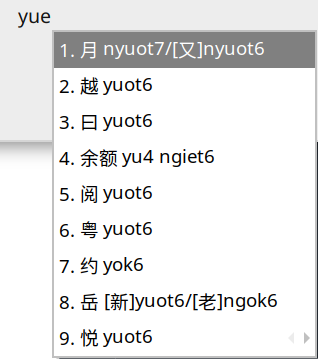
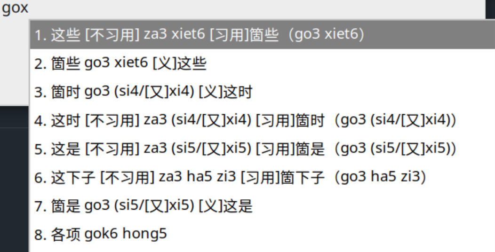
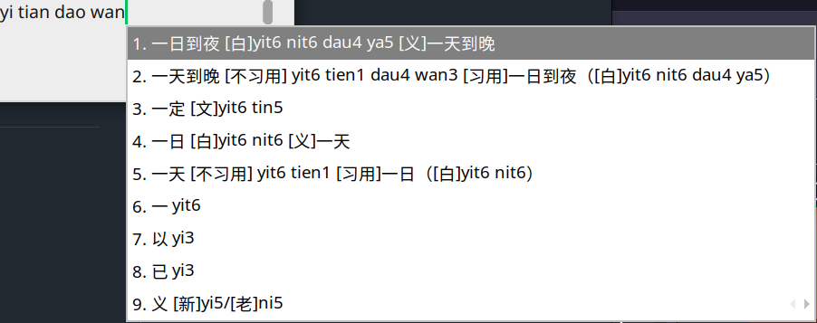
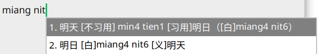
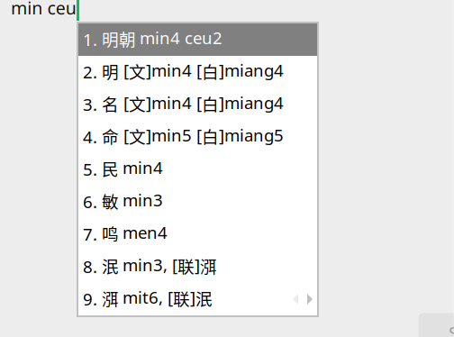
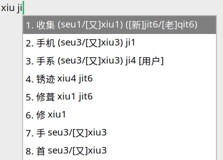

# 赣语通用输入法 GonnyuGeneralIME | 赣拼 GonPin

**简体中文** | [English](README.en.md)

> 一种属于赣鄱大地的数字化书写方案。

目前支持：**南昌话(Lancong)、分宜话(Fenni)、丰城话(Fungcen)、黎川话（Tiqien）、新余话（Sinyi）、上高话（Songau）、宿松话（Seusong）、吉安话（Jingon）、弋阳话-横峰话（Yikyan-Henfeng）、吉水八都话（Jisuibaedu）、遂川话（Xyucuênn）、星子话（Singzï）、高安话（Goungon）**，更多地区等你来接入，已有地区也等你来增补！

[](CONTRIBUTION.md)

**一键安装/简单易用/日常可用的赣语输入法，会拼音就能使用，赣语拼音与普通话兼容支持。不会说赣语也能用来玩！用赣语思维也可以轻松大段输出普通话文本（比如本文）！**

**现已上架ios应用商店（"赣语输入法"），支持 macOS、Android、Windows、Linux 的快捷安装，以及各平台 Rime 资源包。**

[](https://github.com/Doohaey/GonnyuGeneralIME-Rime-Lancong)
[](https://github.com/Doohaey/GonnyuGeneralIME-Rime-Fenni)
[](https://github.com/Doohaey/GonnyuGeneralIME-Rime-Fungcen)
[](https://github.com/Doohaey/GonnyuGeneralIME-Rime-Yikyan-Henfeng)
[](https://github.com/Doohaey/GonnyuGeneralIME-Rime-Sinyi)
[](https://github.com/Doohaey/GonnyuGeneralIME-Rime-Goungon)

上方按钮列出已发布的 Rime 方案仓库。其他安装方案请在下方[安装方法](#安装方法)小节找到对应平台内容下载并且安装。

## 正式版本 1.3.1

- data: 增补南昌词典。
- fix: 修正二式介音拼写问题。

## 目录

- [赣语通用输入法 GonnyuGeneralIME](#赣语通用输入法-gonnyugeneralime)
  - [正式版本 1.3.1](#正式版本-131)
  - [目录](#目录)
  - [简介](#简介)
    - [特色](#特色)
  - [功能演示](#功能演示)
    - [无需学习，凭感觉就可以打](#无需学习凭感觉就可以打)
    - [收词广泛，本地风土全概览，生僻输入无压力](#收词广泛本地风土全概览生僻输入无压力)
    - [赣语与普通话，同屏就能选](#赣语与普通话同屏就能选)
    - [普通话拼音，直达赣语](#普通话拼音直达赣语)
    - [文白异读，分得清也选得到](#文白异读分得清也选得到)
    - [多读音、新老派，都照顾到](#多读音新老派都照顾到)
  - [安装方法](#安装方法)
    - [macOS](#macos)
    - [iOS](#ios)
    - [Android](#android)
    - [Windows](#windows)
    - [Linux：Fcitx5](#linuxfcitx5)
    - [Rime](#rime)
    - [输入设置](#输入设置)
  - [本输入法采用的通用赣语拼音方案](#本输入法采用的通用赣语拼音方案)
    - [一式（汉拼式）](#一式汉拼式)
      - [声母](#声母)
        - [声母音段](#声母音段)
      - [韵母](#韵母)
        - [韵母音段](#韵母音段)
        - [开口呼韵母](#开口呼韵母)
        - [齐齿呼韵母](#齐齿呼韵母)
        - [合口呼韵母](#合口呼韵母)
        - [撮口呼韵母](#撮口呼韵母)
        - [边鼻韵](#边鼻韵)
      - [声调](#声调)
        - [南昌（Lancong）](#南昌lancong)
        - [丰城（Fungcen）](#丰城fungcen)
        - [黎川（Tiqien）](#黎川tiqien)
        - [新余市（Sinyi）](#新余市sinyi)
        - [上高（Songau）](#上高songau)
        - [宿松（Seusong）](#宿松seusong)
        - [吉安市（Jingon）](#吉安市jingon)
        - [弋阳-横峰（Yikyan-Henfeng）](#弋阳-横峰yikyan-henfeng)
        - [吉水八都（Jisuibaedu）](#吉水八都jisuibaedu)
        - [遂川（Xyucuênn）](#遂川xyucuênn)
        - [星子（Singzï）](#星子singzï)
        - [高安（Goungon）](#高安goungon)
    - [二式（组合式）](#二式组合式)
    - [额外说明](#额外说明)
  - [参考](#参考)
    - [文献](#文献)
    - [参考实现](#参考实现)
    - [依赖声明](#依赖声明)
    - [许可与权利保留](#许可与权利保留)
    - [致谢](#致谢)
  - [参与名单与联系方式](#参与名单与联系方式)

## 简介

2025年下半年，我们萌生制作赣语通用输入法的想法。在此之前，我们对其他汉语的输入法有过一定观察。起初，我们把赣语语音与文字的对应依靠多种资料进行了整理，建立了最基本的词典。但是很快，我们认为这样的简单对应似乎还不足以适合我们现有的需求。我们希望以另一种形式系统性整理保存赣语各个点位的语料。因此就有了我们现有的项目设想：不仅是可以以赣语语音输入汉字，还要能让使用者可以用赣语思维顺利输入普通话，也可以让赣语不太熟练但是听过的年轻一代，抑或只是对赣语感兴趣的爱好者，都可以借此输入地道的赣语文本。

由此可见，我们的“通用“有三个含义。第一，是在赣语各个点位通用。第二，是赣语普通话之间通用。第三，是技术意义上全平台通用。

我们项目尽可能使用地道的本字、正字，兼顾民间常用写法，可以引导用户一种规范且兼顾通俗的地方汉语文本。

### 特色

除基本词典之外，已经实现的功能有：

- 对字词等进行标音，拼音方案和调号将在下面解释。本套拼音方案大体上是接近汉语拼音方案的，主要是出于低学习成本上手的考虑。
- 兼容普通话输入法使用者容易使用的习惯拼写方法。当然，最终显示还是以本套方案拼音为准。
- 对普通话常用词与赣语点位常用词进行对应。互相进行解释。当被对应的一方被索引到候选词列表时，另一方也会出现，以方便使用赣语输入普通话或使用普通话输入赣语的目的。
- 对于词汇文白读音，新派老派读音，或者一些另读进行兼容输入和清晰标注。

目前，我们已经建成13个词典点位。另希望就别的点位进行充分扩展。欢迎参与我们的词典增添与校正！

## 功能演示

<sub>以下演示以南昌话输入部分为例。</sub>

### 无需学习，凭感觉就可以打

根据汉语拼音用户习惯的强大兼容，凭感觉就可以打出你心理所想。



### 收词广泛，生僻输入无压力

收录汉字20000+（UNICODE扩展B区已经大量覆盖，理论读音根据韵书推导），词汇100000+，大量本地地道表达，地名特有读音，并非只有少量字音的半成品！


### 赣语与普通话，同屏就能选

输入赣语，相关普通话词也会一起出现；理解、确认、选词，一步到位。



### 普通话拼音反查

不会赣语，直接可以以普通话查询。



### 文白异读完整体现

文白异读等层次，清晰展现。





### 多读音、新老派兼顾

兼顾多种通行读音，充分兼容多种语音、混读。




## 安装方法

输入法主体覆盖 Linux、Android、Windows 和 macOS。如使用通用 Rime 资源包，安装方法见 Rime 章节。

从 [Releases](https://github.com/Doohaey/GonnyuGeneralIME/releases) 下载与系统相符或者对应区域的文件。

### macOS

从 [Releases](https://github.com/Doohaey/GonnyuGeneralIME/releases) 下载 `GonnyuGeneralIME-版本号-macos.pkg`，双击打开并完成安装。

若安装后未自动显示：打开“系统设置 → 键盘 → 文本输入 → 编辑…”，点击“+”，搜索并添加“Gonnyu”，再从输入法菜单切换至它。升级会保留用户词库。

由于系统特性，碰到系统设置中添加输入法时列表中没有，添加后还无法切换等情况，请尝试注销重登。

### iOS

iOS 上使用输入法时，除法国用户外，请直接到app store下载＂赣语输入法＂。

### Android

下载 `GonnyuGeneralIME-版本号-android.apk`，在 Android 系统中打开并安装。首次打开应用后，按应用内引导启用“赣语输入法”，再在系统输入法选择器中切换至它。

### Windows

下载并运行 `GonnyuGeneralIME-版本号-windows-installer.exe`，按安装向导完成安装。随后在“设置 → 时间和语言 → 语言和区域 → 中文（简体） → 键盘”中添加“Gannyu”。

### Linux：Fcitx5

一式与二式分别打包：一式下载 `GonnyuGeneralIME-版本号-fcitx5-gonnyu.tar.gz`，二式下载 `GonnyuGeneralIME-版本号-fcitx5-gonnyu_II.tar.gz`。解压后运行包内安装程序：

```sh
mkdir GonnyuGeneralIME-fcitx5
tar -xzf GonnyuGeneralIME-版本号-fcitx5-gonnyu.tar.gz -C GonnyuGeneralIME-fcitx5
cd GonnyuGeneralIME-fcitx5
./install.sh
```

重启 Fcitx5（`fcitx5 -r`）或注销后重新登录，并在 `fcitx5-configtool` 中添加“GonnyuGeneralIME / 赣语（一式）”或“GonnyuGeneralIME (Compositional) / 赣语（二式）”。

### Rime

每个地区提供两个独立安装包：

- `GonnyuGeneralIME-版本号-rime-地区.zip`：一式（汉拼式）
- `GonnyuGeneralIME-版本号-rime-地区-II.zip`：二式（组合式）

只使用其中一种方案时，下载对应 ZIP 即可。想同时使用一式、二式时，把两个 ZIP 都安装到同一个 Rime 用户目录。

**Windows 小狼毫**

1. 下载需要的 ZIP。
2. 解压后，把文件复制到 `%APPDATA%\Rime`。
3. 在输入法菜单中选择“重新部署”。
4. 在方案菜单中选择“赣语－地区（一式·汉拼式）”或“赣语－地区（二式·组合式）”。

**Linux Fcitx5 Rime**

1. 下载需要的 ZIP。
2. 解压后，把文件复制到 `~/.local/share/fcitx5/rime/`。
3. 重新部署 Rime。
4. 在方案菜单中选择所需方案。

**iOS、Android**

在已安装的 Rime 前端中使用导入或部署功能载入所需 ZIP，然后从方案菜单选择方案。

如果同时安装一式、二式两个包，请在 `default.custom.yaml` 的方案列表中保留两个方案。

### 输入设置

各开关默认开启，读音模式默认为“新老兼有”。设置切换后生效，无需重新安装或部署。

| 设置项目 | 作用 |
| --- | --- |
| 副标题 | 显示或隐藏候选词的读音和注释。 |
| 赣普词语连带 | 控制赣语词与官话对应词的连带候选及相关注释；关闭时过滤官话词，保留单字候选。 |
| 同义词连带 | 控制同义词连带候选及相关注释。与赣普词语连带、副标题分别设置。 |
| 模糊匹配 | 总开关，下属“普拼兼容”“文白匹配”“其他模糊规则”。普拼兼容允许用普通话拼音匹配词语；文白匹配允许文读、白读互相匹配，关闭后保留文白标题；其他模糊规则控制特殊 i、e、o 音位兼容（ï、ê、ô）之外的模糊匹配。 |
| 读音模式 | 选择“新老兼有”“新派”或“老派”，同时调整读音匹配和副标题中的新老派显示。 |
| 方案 | 选择一式（汉拼式）或二式（组合式）；地区未启用二式时只能选一式。 |

模糊匹配关闭后，三个子项停止生效并保留选择；移动端子项变灰。

| 平台 | 操作入口 |
| --- | --- |
| macOS | 点击菜单栏“赣·地区”，打开“输入设置”。 |
| Windows | 使用赣语输入法时，在语言栏打开“输入设置”。 |
| iOS、Android | 打开赣语输入法主应用，在“输入设置”中调整。 |
| Rime | 打开所用前端的方案选单，切换对应开关或读音模式。 |
| Linux Fcitx5 原生版 | 安装“gonnyu”（一式·汉拼式）或“gonnyu_II”（二式·组合式）独立输入法；不提供运行时方案开关。 |

## 本输入法采用的通用赣语拼音方案

本项目设计的通用赣语拼音除尽可能涵盖各点位各音位前提下，处理了一批必要的音位对立，还对赣语内部部分点位的鼻化韵、浊音进行合理化表达。当然，考虑新派归并特点以及输入方便，拼音不对所有语音细节（如气声或弛声等）进行准确刻画，也合并了一批在各个点位无实际差别/仅仅是异读的音值。

本输入法提供一式（汉拼式）与二式（组合式）两套并行方案，可在输入设置中切换。

### 一式（汉拼式）

为符合输入实际，本项目所使用的通用赣语拼音(gon-pin)一式在反映赣语发声实际的基础上，尽可能贴近《汉语拼音方案》的拼写模式。

#### 声母

##### 声母音段

下表按音段列出声母拼写；方括号内为 IPA。

| 部位 | 塞音清 | 塞音次清 | 塞音浊 | 塞擦音清 | 塞擦音次清 | 塞擦音浊 | 擦音清 | 擦音浊 | 鼻音 | 边音 |
| --- | --- | --- | --- | --- | --- | --- | --- | --- | --- | --- |
| 双唇 | b[p] | p[pʰ] | bb[b] | — | — | — | f[ɸ] | — | m[m] | — |
| 唇齿 | — | — | — | — | — | — | f[f] | v[v] | — | — |
| 舌尖前 | — | — | — | z[ts] | c[tsʰ] | zz[dz] | s[s] | — | — | — |
| 舌尖中 | d[t] | t[tʰ] | dd[d] | — | — | — | — | — | n[n] | l[l] |
| 舌叶 | — | — | — | — | — | — | — | — | — | — |
| 舌尖后 | — | — | — | zh[tʂ] | ch[tʂʰ] | zzr[dʐ] | sh[ʂ] | r[ʐ] | n[ɳ] | — |
| 舌面前 | — | — | — | j[tɕ] | q[tɕʰ] | jj[dʑ] | x[ɕ] | — | n[ȵ] | — |
| 舌面中 | — | — | — | — | — | — | — | — | — | — |
| 舌根 | g[k] | k[kʰ] | gg[ɡ] | — | — | — | h[x] | — | ng[ŋ] | — |
| 喉 | — | — | — | — | — | — | h[h] | — | — | — |

| gon-pin | 南昌IPA | 丰城IPA | 黎川IPA | 新余市IPA | 上高IPA | 宿松IPA | 吉安市IPA | 弋阳-横峰IPA | 吉水八都IPA | 遂川IPA | 星子IPA | 高安IPA | 兼容输入 | 说明 |
| ------- | ------- | -------- | ------- | ------- | ------- | ------- | ------- | ------- | ------- | ------- | ------- | ------- | -------- | --------------------------------------------- |
| ∅ | []或[ʔ] | - | - | - | - | - | - | - | - | - | - | - | — | 零声母，[ʔ]为特殊情况。 |
| b | [p] | [p] | [p] | [p] | [p] | [p] | [p] | [p] | [p] | [p] | [p] | [p] | — |  |
| p | [pʰ] | [pʰ] | [pʰ] | [pʰ] | [pʰ] | [pʰ] | [pʰ] | [pʰ] | [pʰ] | [pʰ] | - | [pʰ] | — |  |
| m | [m] | [m] | [m] | [m] | [m] | [m] | [m] | [m] | [m] | [m] | [m] | [m] | — |  |
| f | [ɸ]或[f] | [f] | [f] | [ɸ]或[f] | [f] | [f] | [f] | [f] | [f] | [f] | [f] | [f] | — | 主流记[f]，也有认为与[ɸ]接近，为双唇音。 |
| d | [t] | [t] | [t] | [t] | [t] | [t] | [t] | [t] | [t] | [t] | [t] | [t] | — |  |
| t | [tʰ] | [tʰ] | [tʰ] | [tʰ] | [tʰ] | [tʰ] | [tʰ] | [tʰ] | [tʰ] | [tʰ] | - | [tʰ] | — |  |
| l | [l] | [l] | [l] | [l] | [l] | [l] | [l] | [l] | [l] | [l] | [l] | [l] | — |  |
| z | [ts] | [ts] | [ts] | [ts] | [ts] | [ts] | [ts] | [ts] | [ts] | [ts] | [ts] | [ts] | — |  |
| c | [tsʰ] | [tsʰ] | [tsʰ] | [tsʰ] | [tsʰ] | [tsʰ] | [tsʰ] | [tsʰ] | [tsʰ] | [tsʰ] | - | [tsʰ] | — |  |
| s | [s] | [s] | [s] | [s] | [s] | [s] | [s] | [s] | [s] | [s] | [s] | [s] | — |  |
| j | [tɕ] | [tɕ] | [tɕ] | [tɕ] | [tɕ] | [tɕ] | [tɕ] | [tɕ] | [tɕ] | [tɕ] | [tɕ] | [tɕ] | — |  |
| q | [tɕʰ] | [tɕʰ] | [tɕʰ] | [tɕʰ] | [tɕʰ] | [tɕʰ] | [tɕʰ] | [tɕʰ] | [tɕʰ] | [tɕʰ] | - | [tɕʰ] | — |  |
| n | [ȵ] | [ȵ] | [n] | [ȵ] | [ȵ] | [n]或[ɳ]或[ȵ] | [ȵ] | [n]或[ȵ] | [ɳ] | [n]或[ȵ] | [n]或[ȵ] | - | — |  |
| x | [ɕ] | [ɕ] | [ɕ] | [ɕ] | [ɕ] | [ɕ] | [ɕ] | [ɕ] | [ɕ] | [ɕ] | [ɕ] | [ɕ] | — |  |
| g | [k] | [k] | [k] | [k] | [k] | [k] | [k] | [k] | [k] | [k] | [k] | [k] | — |  |
| k | [kʰ] | [kʰ] | [kʰ] | [kʰ] | [kʰ] | [kʰ] | [kʰ] | [kʰ] | [kʰ] | [kʰ] | - | [kʰ] | — |  |
| ng | [ŋ] | [ŋ] | [ŋ] | [ŋ] | [ŋ] | [ŋ] | [ŋ] | [ŋ] | [ŋ] | [ŋ] | [ŋ] | [ŋ] | — | 舌根鼻音 |
| h | [h] | [x]或[h] | [h] | [h] | [x] | [x] | [x]或[h] | [x] | [x] | [h] | [x] | [h] | — | [h]发音位置与普通话h不同，更加靠后。 |
| v | - | [v] | [v] | - | [v] | - | - | - | - | - | - | - | w、wu（音节开头，单向） |  |
| ch | - | - | - | - | - | [tʂʰ] | - | - | - | - | - | - | — |  |
| r | - | - | - | - | - | [ʐ] | - | - | - | - | - | - | — |  |
| sh | - | - | - | - | - | [ʂ] | - | - | - | - | [ʂ] | - | — |  |
| zh | - | - | - | - | - | [tʂ] | - | - | - | - | [tʂ] | - | — |  |
| bb | - | - | - | - | - | - | - | - | - | - | [b] | - | b（单向） |  |
| dd | - | - | - | - | - | - | - | - | - | - | [d] | - | d（单向） |  |
| gg | - | - | - | - | - | - | - | - | - | - | [ɡ] | - | g（单向） |  |
| jj | - | - | - | - | - | - | - | - | - | - | [dʑ] | - | j（单向） |  |
| zz | - | - | - | - | - | - | - | - | - | - | [dz] | - | z（单向） |  |
| zzr | - | - | - | - | - | - | - | - | - | - | [dʐ] | - | zr、zh、zzh（单向） |  |

#### 韵母

##### 韵母音段

下表按音段列出元音、韵尾和边鼻韵拼写。

|  | 前不圆唇 | 前圆唇 | 央不圆唇 | 央圆唇 | 后不圆唇 | 后圆唇 |
| --- | --- | --- | --- | --- | --- | --- |
| 舌尖 | i(ï)[ɿ][ʅ] | yu[ʯ] | — | — | — | — |
| 高 | i[i] | yu[y] | e[ɨ] | — | — | u[u] |
|  | e[ɪ] | — | — | — | — | — |
| 半高 | e(ê)[e] | oe[ø] | — | eo[ɵ] | e[ɤ] | o[o] |
| 中 | — | — | e[ə] | — | — | — |
| 半低 | e(ê)[ɛ] | oe[œ] | — | — | — | o(ô)[ɔ] |
|  | ae[æ] | — | — | — | — | — |
| 低 | a[a] | — | — | — | a[ɑ] | — |

韵尾：

| 拼写 | 国际音标IPA |
| --- | --- |
| p | [p] |
| t | [t] |
| k | [k] |
| k | [ʔ] |
| m | [m] |
| n | [n] |
| ng | [ŋ] |

边鼻韵：

| 拼写 | 国际音标IPA |
| --- | --- |
| m | [m̩] |
| n | [n̩] |
| ng | [ŋ̩] / [ŋ̍] |
| l | [ɭ̩] |

**入声标记与兼容**如下：

- 韵尾 `[-ʔ]` 统一标记为赣拼 `-k`。大部分主要赣语点位-k尾已经不存在。建宁保留完整-p,-t,-k三分，但是[-ʔ]不存在，故跟[-k]也不对立。
- 入声韵尾可以省略输入，仍可匹配对应读音。
- 各地区独立指定 `-t`、`-p`、`-k` 的任意组合，也可以不设入声；同一地区已启用的入声韵尾之间互相兼容。

##### 开口呼韵母

| gon-pin | 南昌IPA | 丰城IPA | 黎川IPA | 新余市IPA | 上高IPA | 宿松IPA | 吉安市IPA | 弋阳-横峰IPA | 吉水八都IPA | 遂川IPA | 星子IPA | 高安IPA | 兼容输入 | 说明 |
| ------- | ------- | -------- | ------- | ------- | ------- | ------- | ------- | ------- | ------- | ------- | ------- | ------- | -------- | ---- |
| ae | - | [æ] | - | - | [æ] | [æ] | [æ] | - | [æ] | [æ] | - | - | — |  |
| a | [a] | [a] | [a] | [a] | [a] | [a] | [a] | [a] | [a] | [a] | [a] | [a] | — |  |
| o* | [o] | [o] | [ɔ] | [o] | [o] | [o] | [o]或[ɔ] | [o] | [o] | [o]或[ɔ] | [o]或[ɔ] | [ɔ] | oo（→ ô） |  |
| oe | - | - | - | [ø] | - | - | [œ] | - | - | - | - | - | — |  |
| e* | [e]或[ə] | [ə]或[ɛ] | [ɛ] | [e]或[ɛ] | [ə] | [e] | [ə]或[ɛ] | [ə]或[ɛ] | [ə]或[ɛ] | [e]或[ɤ]或[ɛ] | [ɛ] | [ə]或[ɛ] | ir（→ e）、er（→ e），ee（→ ê） |  |
| eo | [ɵ] | [ɵ] | [ɵ] | [ɵ] | - | - | [ɵ] | - | - | - | - | [ɵ] | o（独立成音节，单向） |  |
| ai | [ai] | [ai] | [ai] | [ai] | [ai] | [ai] | [ai] | [ai] | [ai] | [ai] | [ai] | [ai] | — |  |
| oi | [oi] | [oi] | [ɔi] | [oi]或[ɔi] | [ɔi] | - | [ɔi] | [oi] | - | - | - | [ɔi] | — |  |
| ei | [ɨi]或[ei] | [ɛi] | [ɛi] | [əi] | - | [ei] | [ei] | [ei] | - | - | [ei] | [ei]或[əi]或[ɛi] | — | － |
| eoi | - | - | - | [ɵi] | - | - | - | - | - | - | - | - | — |  |
| aeu | - | - | - | - | [æu] | - | - | - | - | - | - | - | — |  |
| au | [au] | [ɑu] | [au] | [au] | [au] | [ɑu] | [au] | [au] | [au] | - | [au] | [au] | ao |  |
| ou | - | - | [ɔu] | - | - | - | - | [ɔu] | - | - | - | [ɔu] | — |  |
| eu | [ɨu]或[ɛu] | [əu]或[ɛu] | [ɛu] | [ɪu]或[ɛu] | - | [əu] | [ɛu] | [əu]或[ɛu] | [ɛu] | - | [eu]或[ɛu] | [əu]或[ɛu] | ou（部分声母后）、ieu（h 后） |  |
| am | - | [am] | [am] | - | - | - | - | - | - | - | - | - | — |  |
| om | - | - | [ɔm] | - | - | - | - | - | - | - | - | - | — |  |
| em | - | - | [ɛm] | - | - | - | - | - | - | - | - | - | — |  |
| aen | - | - | - | - | [æn] | - | - | - | - | - | - | - | — |  |
| an | [an] | [an] | [an] | [an] | [an] | [an] | [an] | [an] | [an] | - | [an] | [an] | — |  |
| on | [on] | [on] | [ɔn] | [on]或[ɔn] | [ɔn] | [on] | [on]或[ɔn] | [on] | [on] | - | [on] | [ɔn] | — |  |
| oen | - | - | - | [øn] | - | - | - | - | - | - | - | - | — |  |
| en | [ɨn]或[ɛn] | [ən]或[ɛn] | [ən]或[ɛn] | [ɪn]或[ɛn] | [ən] | [ən] | [ən]或[ɛn] | [en]或[ən]或[ɛn] | [ɛn] | - | [en]或[ɛn] | [ən]或[ɛn] | ing（丰城） |  |
| eon | - | - | - | - | - | - | - | - | - | - | - | [ɵn] | — |  |
| ann* | - | - | - | - | - | - | - | - | - | [ã] | - | - | an |  |
| ang | [ɑŋ] | [ɑŋ] | [ɑŋ] | [ɑŋ] | - | [ɑŋ] | [ɑŋ] | - | [ɑŋ] | - | [ɑŋ] | [ɑŋ] | — |  |
| ong | [ɔŋ] | [oŋ] | [ɔŋ] | [oŋ] | - | [oŋ] | [ɔŋ] | [ɔŋ] | [oŋ] | [ɔŋ] | [ɔŋ] | [ɔŋ] | on（弋阳） | 弋阳ong不分前后 |
| eng | - | - | [ɛŋ] | - | - | - | [əŋ] | [əŋ] | - | [ɤŋ] | [eŋ] | - | en（弋阳） | 弋阳大部分人已不区分en和eng |
| aet | - | [æt] | - | - | [æt] | - | - | - | - | - | - | - | — |  |
| at | [at] | [at] | - | [at] | [at] | - | - | - | - | - | - | [at] | — |  |
| ot | [ot] | [ot] | - | [ɔt] | [ot]或[ɔt] | - | - | - | - | - | - | [ɔt] | — |  |
| oet | - | - | - | [øt] | - | - | - | - | - | - | - | - | — |  |
| et | [ɨt]或[ɛt] | [ɛt] | - | [ɪt]或[ət]或[ɛt] | - | - | - | - | - | - | - | [ət]或[ɛt] | — |  |
| eot | - | [ɵt] | - | - | - | - | - | - | - | - | - | - | — |  |
| aep | - | [æp] | - | - | - | - | - | - | - | - | - | - | — |  |
| ap | - | [ap] | [ap] | - | - | - | - | - | - | - | - | - | — |  |
| op | - | - | [ɔp] | - | - | - | - | - | - | - | - | - | — |  |
| ep | - | - | [ɛp] | - | - | - | - | - | - | - | - | - | — |  |
| eop | - | [ɵp] | - | - | - | - | - | - | - | - | - | - | — |  |
| aek | - | [æʔ] | - | - | [æʔ] | - | - | - | - | - | - | - | — |  |
| ak | [aʔ] | [aʔ] | [aʔ] | [ak]或[aʔ] | [aʔ] | - | - | [aʔ] | - | [aʔ] | - | [aʔ] | — |  |
| aik | - | - | [aiʔ] | [aiʔ] | - | - | - | - | - | - | - | - | — |  |
| ok | [oʔ]或[ɔʔ] | [oʔ]或[ɔʔ] | [ɔʔ] | [ok]或[oʔ]或[ɔʔ] | [ɔʔ] | - | - | [ɔʔ] | - | [oʔ] | - | [ɔʔ] | uok（弋阳） |  |
| oek | - | - | - | [øʔ] | - | - | - | - | - | - | - | - | — |  |
| oik | - | - | [ɔiʔ] | - | - | - | - | - | - | - | - | - | — |  |
| ek | - | [ɨʔ]或[ɛʔ] | [ɛʔ] | [əʔ]或[ɛʔ] | - | - | - | [ɪʔ]或[ɛʔ] | - | [eʔ] | - | - | — |  |
| eok | - | [ɵʔ] | - | - | - | - | - | - | - | - | - | - | — |  |

\* 鼻化韵在韵母末尾用 `nn` 标记；输入末尾单写 `n` 可单向匹配双写 `nn`，如 `an`→`ann`。表中其他鼻化韵也遵循此规则。有韵尾时不写 `nn`。

\* 部分地区用 `ê` 表示 IPA [ɛ] 或 [e]；单写 `e` 即可匹配 `ê`，`ir`、`er` 精确对应赣拼`e`，`ee` 精确对应赣拼 `ê`。其他韵母中的 `ê` 同样适用。

\* 部分地区用 `ô` 表示 IPA [ɔ]；单写 `o` 即可匹配 `ô`，`oo` 精确对应赣拼 `ô`。其他韵母中的 `ô` 同样适用。

##### 齐齿呼韵母

若该类韵母前零声母：
- i 后接 -a、-o、-e之时，i 转写为 y。
- i 后接 -u 之时，如构成独立音节 iu，或 iu 直接连接入声韵尾之形式，将音节整体转写为 yiu（+入声韵尾），以与 yu 区分；否则只将 i 转写为 y。
- 其他情况将 i（含ï）转写作 yi（yï）。

| gon-pin | 南昌IPA | 丰城IPA | 黎川IPA | 新余市IPA | 上高IPA | 宿松IPA | 吉安市IPA | 弋阳-横峰IPA | 吉水八都IPA | 遂川IPA | 星子IPA | 高安IPA | 兼容输入 | 说明 |
| ------- | ------- | -------- | ------- | ------- | ------- | ------- | ------- | ------- | ------- | ------- | ------- | ------- | -------- | ---- |
| i* | [ɿ]或[i] | [i] | [ɿ]或[i] | [ɿ]或[i] | [i] | [ʅ]或[ɿ]或[i] | [ɿ]或[i] | [ɿ]或[i] | [ɿ]或[i] | [ɿ]或[i] | [ʅ]或[ɿ]或[i] | [i] | ii（→ ï） |  |
| iae | - | - | - | - | [iæ] | - | - | - | - | [iæ] | - | - | — |  |
| ia | [ia] | [ia] | [ia] | [ia] | [ia] | [ia] | [ia] | [ia] | [ia] | [ia] | [ia] | [ia] | — |  |
| io | - | [iɔ] | [iɔ] | [io] | - | [io] | [io]或[iɔ] | [io] | [io] | [io]或[iɔ] | [io]或[iɔ] | [iɔ] | - |  |
| ie | [ie] | [iɛ] | [iɛ] | [ie]或[iɛ] | [iɛ] | [ie] | [iɛ] | [iɛ] | [iɛ] | [ie] | [iɛ] | [iɛ] | — |  |
| iai | - | - | - | [iai] | - | - | - | - | - | - | - | - | — |  |
| ioi | - | - | - | [ioi]或[iɔi] | - | - | - | - | - | - | - | - | — |  |
| iu* | [iu] | [iu] | [iu] | [iu] | [iu] | - | [iu] | [iu] | [iu] | [iu] | [iu] | [iu] | you（零声母） |  |
| iaeu | - | - | - | - | [iæu] | - | - | - | - | - | - | - | — |  |
| iau | - | [iau] | [iau] | [iau] | - | [iɑu] | [iau] | [iau] | [iau] | - | [iau] | [iau] | - |  |
| iou | - | - | - | - | - | - | [iɔu] | - | [iou] | - | - | - | — |  |
| ieu | [iɛu] | [iəu]或[iɛu] | - | [iɛu] | [iɛu] | [iəu] | - | [iəu] | - | - | - | [iɛu] | eu（g、k、ng 后） |  |
| im | - | [im] | [im] | - | - | - | - | - | - | - | - | - | - |  |
| iam | - | - | [iam] | - | - | - | - | - | - | - | - | - | — |  |
| in | [in] | [in] | [in] | [in] | [in] | [in] | [in] | [in] | [in] | - | [in] | [in] | — |  |
| iaen | - | - | - | - | [iæn] | - | - | - | - | - | - | - | — |  |
| ian | - | [ian] | - | [ian] | [ian] | - | - | [ian] | - | - | - | - | - |  |
| ion | - | - | - | [ion]或[iɔn] | [iɔn] | - | - | - | - | - | - | [iɔn] | — |  |
| ien | [iɛn] | [iɛn] | [iɛn] | [ien]或[iɛn] | [iɛn] | [iɛn] | [iɛn] | [ien]或[iɛn] | [iɛn] | - | [iɛn] | [iɛn] | en（g、k、ng 后） |  |
| iun | - | - | - | [iun] | - | - | - | - | - | - | - | - | — |  |
| inn | - | - | - | - | - | - | - | - | - | [ĩ] | - | - | in |  |
| iann | - | - | - | - | - | - | - | - | - | [iã] | - | - | ian |  |
| ienn | - | - | - | - | - | - | - | - | - | [iɛ̃] | - | - | ien |  |
| ing | - | - | [iŋ] | - | - | - | - | - | - | - | [iŋ] | - | - |  |
| iang | [iɑŋ] | [iɑŋ] | [iɑŋ] | [iɑŋ] | - | [iɑŋ] | [iɑŋ] | [iɑŋ] | [iɑŋ] | [iɑ̃ŋ] | [iɑŋ] | [iɑŋ] | - |  |
| iong | [iɔŋ] | [ioŋ] | [iɔŋ] | [ioŋ] | - | [ioŋ] | [iɔŋ] | - | [ioŋ] | [iɔŋ] | [iɔŋ] | [iɔŋ] | - |  |
| iung | [iuŋ] | [iuŋ] | [iuŋ] | [iuŋ] | [iuŋ] | - | [iuŋ] | [iuŋ] | [iuŋ] | - | - | [iuŋ] | - |  |
| it | [it] | [it] | - | [it] | [it] | - | - | - | - | - | - | [it] | - |  |
| iat | - | [iat] | - | [iat] | - | - | - | - | - | - | - | - | - |  |
| iot | - | - | - | [iɔt] | - | - | - | - | - | - | - | - | — |  |
| iet | [iɛt] | [iɛt] | - | [iət]或[iɛt] | [iɛt] | - | - | - | - | - | - | [iɛt] | et（ng 后） |  |
| iut | - | - | - | - | - | - | - | - | - | - | - | - | — |  |
| ip | - | [ip] | [ip] | - | - | - | - | - | - | - | - | - | - |  |
| iap | - | [iap] | [iap] | - | - | - | - | - | - | - | - | - | - |  |
| iep | - | [iɛp] | - | - | - | - | - | - | - | - | - | - | — |  |
| ik | [ɿʔ]或[iʔ] | [iʔ] | [iʔ] | [ɿʔ]或[iʔ] | [iʔ] | - | - | [iʔ] | - | - | - | - |  |  |
| iaek | - | - | - | - | [iæʔ] | - | - | - | - | - | - | - | — |  |
| iak | [iaʔ] | [iaʔ] | [iaʔ] | [iaʔ] | [iaʔ] | - | - | [iaʔ] | - | [iaʔ] | - | [iaʔ] | - |  |
| iaik | - | - | - | [iaiʔ] | - | - | - | - | - | - | - | - | — |  |
| iok | [ioʔ]或[iɔʔ] | [iɔʔ] | [iɔʔ] | [ioʔ]或[iɔʔ] | [iɔʔ] | - | - | - | - | [ioʔ] | - | [iɔʔ] | - |  |
| iek | - | [iɛʔ] | [iɛʔ] | [iəʔ]或[iɛʔ] | [iɛʔ] | - | - | [iɪʔ]或[iɛʔ] | - | [ieʔ] | - | - |  |  |
| iuk | [iuʔ] | [iuʔ] | [iuʔ] | [iuʔ] | [iuʔ] | - | - | [iuʔ] | - | - | - | [iuʔ] | - |  |
| iuok | - | - | - | [iuɔʔ] | - | - | - | - | - | - | - | - | — |  |
| iuek | - | - | - | [iuəʔ] | - | - | - | - | - | - | - | - | — |  |

\* `i`: 部分地区用 `ï` 表示 IPA [ɿ] 或 [ʅ]；输入使用 `i`，可单向模糊匹配 `ï`；`ii` 精确输入 `ï`。[ɿ]、[ʅ] 为开口呼，按拼写列于齐齿呼。

##### 合口呼韵母

若该类韵母前零声母：
- u 后接 a、o、e、i 时将 u 转写作 w。
- 其他情况将 u 转写作 wu。

| gon-pin | 南昌IPA | 丰城IPA | 黎川IPA | 新余市IPA | 上高IPA | 宿松IPA | 吉安市IPA | 弋阳-横峰IPA | 吉水八都IPA | 遂川IPA | 星子IPA | 高安IPA | 兼容输入 | 说明 |
| ------- | ------- | -------- | ------- | ------- | ------- | ------- | ------- | ------- | ------- | ------- | ------- | ------- | -------- | ---- |
| u | [u] | [u] | [u] | [u] | [u] | [u] | [u] | [u] | [u] | [u] | [u] | [u] | - |  |
| uae | - | - | - | - | - | [uæ] | - | - | [uæ] | - | - | - | — |  |
| ua | [ua] | [ua] | [ua] | [ua] | - | [ua] | [ua] | [ua] | [ua] | [ua] | [ua] | [ua] | - |  |
| uo | [uo] | [uo] | [uɔ] | [uo] | - | [uo] | [uo] | [uo] | [uo] | [uo] | [uo] | [uɔ] | - |  |
| ue | [ue] | - | [uɛ] | [ue]或[uɛ] | - | - | [uɛ] | [uɛ] | [uɛ] | [ue] | [uɛ] | - | - |  |
| uia | - | - | - | - | - | - | - | - | - | - | [uia] | - | — |  |
| uie | - | [uiɛ] | - | - | - | - | - | - | - | - | - | - | — |  |
| ui | [ui] | [ui] | [ui] | [ui] | - | - | - | [ui] | [ui] | [ui] | - | [ui] | — |  |
| uai | [uai] | [uai] | [uai] | [uai] | - | [uai] | [uai] | [uai] | [uai] | - | [uai] | [uai] | - |  |
| uoi | - | - | [uɔi] | [uoi]或[uɔi] | - | - | - | [uoi] | - | - | - | - | — |  |
| uei | — | [uɛi] | - | [uəi] | - | [uei] | [uei] | [uei] | - | - | [uei] | [uəi]或[uɛi] | ui（声母后，单向） |  |
| ueu | - | - | - | [ueu] | - | - | - | - | - | - | - | - | — |  |
| un | [un] | [un] | [un] | [un] | - | - | [un] | - | [un] | - | - | - | — |  |
| uan | [uan] | [uan] | [uan] | [uan] | - | [uan] | [uan] | [uan] | [uan] | - | [uan] | [uan] | - |  |
| uon | [uon] | [uon] | [uɔn] | [uon]或[uɔn] | - | - | [uon]或[uɔn] | [uon] | [uon] | - | [uon] | [uɔn] | uen, wen（零声母） |  |
| uen | — | [uɛn] | [uɛn] | - | - | [uən] | [uɛn] | [uen]或[uɛn] | - | - | [uen] | [uən]或[uɛn] | un（声母后，单向） |  |
| ueon | - | - | - | - | - | - | - | - | - | - | - | [uɵn] | — |  |
| uin | - | [uin] | - | [uin] | - | - | - | - | - | - | [uin] | - | - |  |
| uien | - | [uiɛn] | - | - | - | - | - | - | - | - | [uiɛn] | - | - |  |
| uann | - | - | - | - | - | - | - | - | - | [uã] | - | - | uan |  |
| uenn | - | - | - | - | - | - | - | - | - | [ũɛ̃] | - | - | un（声母后，单向） |  |
| ung | [uŋ] | [uŋ] | [uŋ] | [uŋ] | [uŋ] | - | [uŋ] | [uŋ] | [uŋ] | - | - | [uŋ] | — |  |
| uang | [uɑŋ] | [uɑŋ] | [uɑŋ] | [uɑŋ] | - | [uɑŋ] | [uɑŋ] | - | [uɑŋ] | [uɑ̃ŋ] | [uɑŋ] | [uɑŋ] | - |  |
| uong | [uoŋ]或[uɔŋ] | [uoŋ] | [uɔŋ] | [uoŋ] | - | - | [uɔŋ] | [uɔŋ] | [uoŋ] | [uɔ̃ŋ] | [uɔŋ] | [uɔŋ] | uon（弋阳） |  |
| ueng | - | - | - | - | - | - | - | [ueŋ] | - | - | [ueŋ] | - | — |  |
| ut | [ut] | [ut] | - | [ut] | [ut] | - | - | - | - | - | - | - | - |  |
| uaet | - | [uæt] | - | - | - | - | - | - | - | - | - | - | - |  |
| uat | [uat] | - | - | [uat] | - | - | - | - | - | - | - | [uat] | - |  |
| uot | [uot] | [uot] | - | [uot]或[uɔt] | - | - | - | - | - | - | - | - | - |  |
| uet | [uət]或[uɛt] | - | - | [uət]或[uɛt] | - | - | - | - | - | - | - | [uət]或[uɛt] | - |  |
| uêt | - | [uɛt] | - | - | - | - | - | - | - | - | - | - | - |  |
| uep | - | - | - | - | - | - | - | - | - | - | - | - | - |  |
| uk | [uʔ] | [uʔ] | [uʔ] | [uʔ] | [uʔ] | - | - | [uʔ] | - | - | - | [uʔ] | - |  |
| uaek | - | [uæʔ] | - | - | - | - | - | - | - | - | - | - | - |  |
| uak | [uaʔ] | [uaʔ] | [uaʔ] | [uaʔ] | - | - | - | [uaʔ] | - | [uaʔ] | - | - | - |  |
| uaik | - | - | [uaiʔ] | [uaiʔ] | - | - | - | - | - | - | - | - | — |  |
| uok | [uɔʔ] | [uoʔ]或[uɔʔ] | [uɔʔ] | [uoʔ]或[uɔʔ] | - | - | - | [uɔʔ] | - | [uoʔ] | - | - | ok（弋阳） |  |
| uoik | - | - | [uɔiʔ] | - | - | - | - | - | - | - | - | - | — |  |
| uek | — | [uɨʔ]或[uɛʔ] | [uɛʔ] | [uɛʔ] | - | - | - | [uəʔ]或[uɛʔ] | - | [ueʔ] | - | - | — |  |
| ueik | - | [uɛiʔ] | - | - | - | - | - | - | - | - | - | - | uik（声母后，单向） |  |
| uik | - | - | [uiʔ] | - | - | - | - | - | - | - | - | - | - |  |

##### 撮口呼韵母

全量用yu表示[y]或者[ʯ].

| gon-pin | 南昌IPA | 丰城IPA | 黎川IPA | 新余市IPA | 上高IPA | 宿松IPA | 吉安市IPA | 弋阳-横峰IPA | 吉水八都IPA | 遂川IPA | 星子IPA | 高安IPA | 兼容输入 | 说明 |
| ------- | ------- | -------- | ------- | ------- | ------- | ------- | ------- | ------- | ------- | ------- | ------- | ------- | -------- | ---- |
| yu | [y] | [y] | [y] | [y] | - | [ʯ] | [y] | [y] | [y] | [y] | - | - | v（仅声母后）、u（仅声母后，且不接在 y 后） |  |
| yuae | - | - | - | - | - | [ʯæ] | - | - | - | - | - | - | — |  |
| yua | - | - | - | - | - | - | - | [ya] | - | - | - | - | — |  |
| yue | [ye]或[yə] | [ye] | - | - | - | - | [yɛ] | [yɛ] | [yə] | [ye] | - | - | - |  |
| yueo | - | [yɵ] | - | - | - | - | - | - | - | - | - | - | — |  |
| yuai | - | - | - | - | - | [ʯai] | - | - | - | - | - | - | — |  |
| yuoi | - | - | - | - | - | - | - | [yoi] | - | - | - | - | — |  |
| yuei | - | - | - | - | - | [ʯei] | - | - | - | - | - | - | — |  |
| yun | [yn] | [yn] | [yn] | - | - | - | [yn] | [yn] | [yn] | - | - | - | — |  |
| yuon | [yon] | [yon] | - | [yɔn] | - | - | [yon]或[yɔn] | [yon] | [yon] | - | - | [yɔn] | yoin（零声母）、yuen |  |
| yuen | - | - | - | - | - | [ʯən]或[ʯɛn] | [yɛn] | [yɛn] | - | - | - | - | yueng |  |
| yuenn | - | - | - | - | - | - | - | - | - | [yɛ̃] | - | - | yuen |  |
| yuinn | - | - | - | - | - | - | - | - | - | [yĩ] | - | - | yuin |  |
| yung | － | - | - | - | - | - | - | [yŋ] | - | - | - | - | yun（弋阳） |  |
| yuong | - | - | - | - | - | - | - | [yɔŋ] | - | - | - | - | — |  |
| yut | [yt] | [yt] | - | [yt] | - | - | - | - | - | - | - | - | - |  |
| yuot | [yot] | - | - | [yɔt] | - | - | - | - | - | - | - | [yɔt] | yue、yuet、yuek |  |
| yuet | - | [yet] | - | - | - | - | - | - | - | - | - | - | - |  |
| yueot | - | [yɵt] | - | - | - | - | - | - | - | - | - | - | — |  |
| yuep | - | [yep] | - | - | - | - | - | - | - | - | - | - | — |  |
| yuk | - | [yʔ] | [yʔ] | [yʔ] | - | - | - | [yʔ] | - | - | - | - | - |  |
| yuak | - | - | - | - | - | - | - | [yaʔ] | - | - | - | - | - |  |
| yuok | - | - | - | [yɔʔ] | - | - | - | [yɔʔ] | - | - | - | - | - |  |
| yuek | - | [yeʔ] | - | [yəʔ] | - | - | - | [yɛʔ] | - | [yeʔ] | - | - | — |  |
| yueok | - | [yɵʔ] | - | - | - | - | - | - | - | - | - | - | — |  |

##### 边鼻韵

| gon-pin | 南昌IPA | 丰城IPA | 黎川IPA | 新余市IPA | 上高IPA | 宿松IPA | 吉安市IPA | 弋阳-横峰IPA | 吉水八都IPA | 遂川IPA | 星子IPA | 高安IPA | 说明 |
| --------- | --------- | --------- | ------- | ------- | ------- | ------- | ------- | ------- | ------- | ------- | ------- | ------- | ------ |
| m | [m̩] | [m̩] | [m̩] | [m̩] | [m̩] | [m̩] | [m̩] | [m̩] | [m̩] | - | [m̩] | [m̩] |  |
| n | [n̩] | - | - | [n̩] | - | [n̩] | - | [n̩] | - | - | [n̩] | - |  |
| ng | [ŋ̍] | [ŋ̩] | [ŋ̍] | [ŋ̍] | [ŋ̍] | - | [ŋ̍] | [ŋ̍] | [ŋ̍] | - | - | [ŋ̍] |  |
| l | - | - | - | - | - | [ɭ̩] | - | - | - | - | - | - |  |

#### 声调

`0` 表示轻声。

##### 南昌（Lancong）

南昌词典的声调标记如下：

| 标号 | 调类 | 调值 |
| --- | --- | --- |
| 1 | 阴平 | 42 |
| 2 | 阳平 | 24 |
| 3 | 上声 | 213 |
| 4 | 阴去 | 44(5) |
| 5 | 阳去 | 21 |
| 6 | 阴入 | 5 |
| 7 | 阳入 | 1 或 2 |

##### 丰城（Fungcen）

丰城词典的声调标记如下：

| 标号 | 调类 | 调值 |
| --- | --- | --- |
| 1 | 阴平 | 35 |
| 2 | 阳平 | 33 |
| 3 | 上声 | 31 |
| 4 | 去声 | 213 |
| 5 | 阴入 | 1 |
| 6 | 阳入 | 5 |

##### 黎川（Tiqien）

黎川词典的声调标记如下：

| 标号 | 调类 | 调值 |
| --- | --- | --- |
| 1 | 阴平 | 22 |
| 2 | 阳平 | 35 |
| 3 | 上声 | 44 |
| 4 | 阴去 | 53 |
| 5 | 阳去 | 13 |
| 6 | 阴入 | 3 |
| 7 | 阳入 | 5 |

##### 新余市（Sinyi）

新余市词典的声调标记如下：

| 标号 | 调类 | 调值 |
| --- | --- | --- |
| 1 | 阴平甲 | 45 |
| 1* | 阴平乙 | 24 |
| 2 | 阳平 | 31 |
| 3 | 上声 | 213 |
| 4 | 去声甲 | 11 |
| 4* | 去声乙 | 33 |
| 5 | 阴入甲 | 5 |
| 5* | 阴入乙 | 24 |
| 6 | 阳入 | 3 |

去声乙、阳入为水北一带声调，在市区分别与阳平、阴入乙合并。

##### 上高（Songau）

上高词典的声调标记如下：

| 标号 | 调类 | 调值 |
| --- | --- | --- |
| 1 | 阴平 | 31 |
| 2 | 阳平 | 24 |
| 3 | 上声 | 213 |
| 4 | 去声 | 51 |
| 5 | 入声 | 4 |

##### 宿松（Seusong）

宿松词典的声调标记如下：

| 标号 | 调类 | 调值 |
| --- | --- | --- |
| 1 | 阴平 | 22 |
| 2 | 阳平 | 35 |
| 3 | 上声 | 51 |
| 4 | 阴去 | 21 |
| 5 | 阳去 | 314 |
| 6 | 入声 | 55 |

##### 吉安市（Jingon）

吉安市词典的声调标记如下：

| 标号 | 调类 | 调值 |
| --- | --- | --- |
| 1 | 阴平 | 334 |
| 2 | 阳平 | 11 |
| 3 | 上声 | 53 |
| 4 | 去声 | 214 |
| 5 | 高升调 | 35 |

##### 弋阳-横峰（Yikyan-Henfeng）

弋阳-横峰词典的声调标记如下：

| 标号 | 调类 | 调值 |
| --- | --- | --- |
| 1 | 阴平 | 44 |
| 2 | 阳平 | 24 |
| 3 | 上声 | 42 |
| 4 | 阴去 | 35 |
| 5 | 阳去 | 21 |
| 6 | 阴入 | 5 |
| 7 | 阳入 | 4 |

##### 吉水八都（Jisuibaedu）

吉水八都词典的声调标记如下：

| 标号 | 调类 | 调值 |
| --- | --- | --- |
| 1 | 阴平 | 44 |
| 2 | 阳平 | 53 |
| 3 | 上声 | 213 |
| 4 | 去声 | 31 |

##### 遂川（Xyucuênn）

遂川词典的声调标记如下：

| 标号 | 调类 | 调值 |
| --- | --- | --- |
| 1 | 阴平 | 52 |
| 2 | 阳平 | 22 |
| 3 | 阴上 | 21 |
| 4 | 阳上 | 25 |
| 5 | 去声甲 | 215 |
| 5* | 去声乙 | 55 |
| 6 | 入声 | 5 |

##### 星子（Singzï）

星子词典的声调标记如下：

| 标号 | 调类 | 调值 |
| --- | --- | --- |
| 1 | 阴平 | 33 |
| 2 | 阳平 | 213 |
| 3 | 上声 | 42 |
| 4 | 阴去甲 | 34 |
| 4* | 阴去乙 | 324 |
| 5 | 阳去 | 21 |
| 6 | 入声 | 35 |

##### 高安（Goungon）

高安声调按同一调号并列列出文献及数据源记法与本项目观点。文献及数据源列沿用词典数据源的调值，本项目观点来源于高安词典贡献者听感、实验语音学测量和文献比较。

| 标号 | 调类 | 文献及数据源调值 | 本项目观点 |
| --- | --- | --- | --- |
| 1 | 阴平 | 35 | 25 |
| 2 | 阳平 | 13 | 213 |
| 3 | 上声 | 42 | 42 |
| 4 | 阴去 | 33 | 33 |
| 5 | 阳去 | 11 | 11 |
| 6 | 阴入 | 5 | 3 |
| 7 | 阳入 | 1 | 1 |

高安词典贡献者提供的两次测量记录如下。表中列出实测值；测1的阳平、上声原记作213、42，测2的阳平原记作13。

| 测量 | 阴平 | 阳平 | 上声 | 阴去 | 阳去 | 阴入 | 阳入 |
| --- | --- | --- | --- | --- | --- | --- | --- |
| 测1 | 25 | 112 | 41 | 33 | 11 | 3 | 1 |
| 测2 | 25 | 12 | 41 | 33 | 11 | 3 | 1 |

贡献者汇总的文献异记还包括阳平213、阴去44或55、阳去22或33、阴入4或3、阳入2或3。多次测量中，阳平为12或112，升幅未到3度；上声为41或42；阴入多为3，接近4；阳入还测得带下降幅度的21。

### 二式（组合式）

#### 声母

| 部位 | 塞音清 | 塞音次清 | 塞音浊 | 塞擦音清 | 塞擦音次清 | 塞擦音浊 | 擦音清 | 擦音浊 | 边塞擦音清 | 边塞擦音次清 | 边擦音清 | 鼻音 | 边音 | 近音 |
| --- | --- | --- | --- | --- | --- | --- | --- | --- | --- | --- | --- | --- | --- | --- |
| 双唇 | p[p] | ph[pʰ] | b[b] | — | — | — | f[ɸ] | v[β] | — | — | — | m[m] | — | — |
| 唇齿 | — | — | — | — | — | — | f[f] | v[v] | — | — | — | — | — | v[ʋ] |
| 舌尖前 | — | — | — | ts[ts] tsl[tθ] | tsh[tsʰ] | dz[dz] | s[s] | z[z] | ts[tɬ] | tsh[tɬʰ] | s[ɬ] | — | — | — |
| 舌尖中 | t[t] | th[tʰ] | d[d] | — | — | — | — | — | — | — | — | n[n] | l[l] | — |
| 舌叶 | — | — | — | tr[tʃ] | trh[tʃʰ] | dr[dʒ] | sr[ʃ] | zr[ʒ] | — | — | — | — | — | — |
| 舌尖后 | — | — | — | tr[tʂ] | trh[tʂʰ] | dr[dʐ] | sr[ʂ] | zr[ʐ] | — | — | — | nr[ɳ] | — | r[ɻ] |
| 舌面前 | tj[ȶ] | tjh[ȶʰ] | dj[ȡ] | c[tɕ] | ch[tɕʰ] | dzj[dʑ] | x[ɕ] | zj[ʑ] | — | — | — | nj[ȵ] | — | — |
| 舌面中 | kj[c] | khj[cʰ] | gj[ɟ] | — | — | — | — | — | — | — | — | gn[ɲ] | — | — |
| 舌根 | k[k] | kh[kʰ] | g[ɡ] | — | — | — | h[x] | gh[ɣ] | — | — | — | ng[ŋ] | — | — |
| 喉 | -h[ʔ] | — | — | — | — | — | h[h] | gh[ɦ] | — | — | — | — | — | — |

- 送气浊音在辅音后加 `h`；`[ɦ]` 与 `[ɡʰ]` 都拼作 `gh`。
- 声母本身带 `-j` 时，拼写省去 `-i-` 介音。

#### 韵母

二式韵母由元音表与韵尾直接组合。

|  | 前不圆唇 | 前圆唇 | 央不圆唇 | 央圆唇 | 后不圆唇 | 后圆唇 |
| --- | --- | --- | --- | --- | --- | --- |
| 舌尖 | ii[ɿ][ʅ] | yu[ʮ][ʯ] | — | — | — | — |
| 高 | i[i] | y[y] | ir[ɨ] | yr[ʉ] | ur[ɯ] | u[u] |
|  | ir[ɪ] | y[ʏ] | — | — | u[ʊ] | — |
| 半高 | e[e] | oe[ø] | er[ɘ] | eo[ɵ] | er[ɤ] | o[o] |
| 中 | — | — | er[ə] | — | — | — |
| 半低 | ee[ɛ] | oe[œ] | er[ɜ] | — | ea[ʌ] | oo[ɔ] |
|  | ae[æ] | — | ar[ɐ] | eo[ɞ] | — | — |
| 低 | a[a] | oe[ɶ] | — | — | a[ɑ] | oa[ɒ] |

韵尾：

| 拼写 | 国际音标IPA |
| --- | --- |
| p | [p] |
| t | [t] |
| k | [k] |
| h | [ʔ] |
| m | [m] |
| n | [n] |
| ng | [ŋ] |

边鼻韵：

| 拼写 | 国际音标IPA |
| --- | --- |
| m | [m̩] |
| n | [n̩] |
| ng | [ŋ̍] / [ŋ̩] |
| l | [ɭ̩] |

鼻化用 `nn` 表示；若鼻化元音仍有鼻音韵尾，只写韵尾。

#### 声调

二式声调采用通用编号。

| 调号 | 调类 |
| --- | --- |
| 0 | 轻声 |
| 1 | 阴平 |
| 2 | 阳平 |
| 3 | 上声（阴上） |
| 4 | 阳上 |
| 5 | 去声（阴去） |
| 6 | 阳去 |
| 7 | 入声（阴入） |
| 8 | 阳入 |
| 9 | 特殊调类 |

`*` 表示次调，可与调号组合，如 `1*`。地区调类按调类名称归入上述通用编号。

### 额外说明

1. 在以上音节成分之外，实际还参考某些文献和生活中发现的音变做了一些扩充表示。其中，包括了1935年所做的语言调查中所记录的一些发音，以及一些特殊的[-n]、[-ng]韵尾音变。
2. 一般来说，对于南昌音系，我们以熊正辉《南昌方言词典》为参考标准。但《南昌方言词典》中也存在少部分口音过于老式、口音过于小众、听感不合实际问题。对此，进行了一定校正。如以赣拼表示的南昌音节fui，在《南昌音系》（1935）资料中记音为[ɸui]，但是在熊正辉《南昌方言词典》中记音为[fɨi]。本音节老派听感不接近于"fei".为了保证输入符合听感，且有依据，采用《南昌音系》(1935)ipa记法。
3.方案切换在输入设置中完成；未启用二式的地区只有一式可选。

## 参考

本项目在制作过程中，除参与者自身生活调查之外，参考了大量相关学术作品与方言爱好者社区的内容。因为语言项目本身性质的缘故，必须从大量来源综合资料。输入法方言词典数据与我们参考的内容已尽可能全部公开，如果有任何版权疑虑，可以联系我们。

### 文献

1. osfans. **MCPDict** [CP/OL]. GitHub. <https://github.com/osfans/MCPDict>.
2. 熊正辉. 《南昌方言的文白读》[EB/OL]. <http://ling.cass.cn/keyan/xueshuchengguo/cgtj/202112/W020211223381176680381.pdf>. 访问日期 2026-06-01.
3. 熊正辉. 《南昌方言里的难字》[EB/OL]. <http://ling.cass.cn/keyan/xueshuchengguo/cgtj/202112/W020211223381177519680.pdf>. 访问日期 2026-06-04
4. 熊正辉. 《南昌方言词典》
5. 赣语中有哪些独有词汇，以便让人立马就能分辨出来它是赣语？ - 知乎 https://www.zhihu.com/question/24262923/
6. Wikipedia:贛語本字 https://gan.wikipedia.org/wiki/
7. Wikipedia:赣语 https://zh.wikipedia.org/zh-hans/%E8%B4%9B%E8%AA%9E
8. 《中国语言资源保护工程汉语方言用字规范》 http://www.moe.gov.cn/s78/A19/tongzhi/201704/W020170405307025943395.pdf. 访问日期2026-08-04.
9. Bilibili 新概念南昌话系列.  https://www.bilibili.com/video/BV1Us4y1C7fp/?share_source=copy_web&vd_source=5078721afbb2afc4394ca2602bb990de
10. 肖萍、肖介汉. 《江西吴城方言词典》[M]. 北京：商务印书馆，2017. 书目信息可参见 [语言学书目汇编](https://geolinguistics.sakura.ne.jp/Monograph/SIG-Mono7-LAAA-3-ebook.pdf).
11. 李荣主编，颜森编纂. 《黎川方言词典》[M]. 南京：江苏教育出版社，1995年12月. ISBN 7-5343-2626-5. [书目](https://cir.nii.ac.jp/crid/1971993809687512866).
12. 杨时逢. 《南昌音系》[J]. 中央研究院历史语言研究所集刊，1969，39（上）：125–204. 含1935年调查资料. [原文](https://www11.ihp.sinica.edu.tw/storage/w2_file/3942MsWGVpd.pdf).
13. 李如龙、张双庆主编. 《客赣方言调查报告》[M]. 厦门：厦门大学出版社，1992. ISBN 7-5615-0385-7. [书目](https://books.google.com/books?id=ApAtAQAAIAAJ).
14. 江西省地方志编纂委员会编，陈昌仪主编. 《江西省方言志》[M]. 北京：方志出版社，2005. 《江西省志》第96卷. ISBN 7-80192-490-8. [书目](https://search.worldcat.org/title/70105497).
15. 萧九根. 《八都方言研究》[D]. 广西大学硕士学位论文，2001.
16. 梅之星. 《高安方言央圆唇元音[ɵ]的变异研究》[D]. 广东外语外贸大学，2020.
17. 南陸（srili）. 知乎主页 [EB/OL]. <https://www.zhihu.com/people/srili>. 访问日期 2026-11-08.
18. 顾国林. **古音小镜·历史语言学** [EB/OL]. <http://www.kaom.net/>. 访问日期 2026-11-10.

### 参考实现

移动端键盘交互参考[仓输入法（Hamster）开源版本](https://github.com/imfuxiao/Hamster)、[同文输入法（Trime）](https://github.com/osfans/trime)与 [HeliBoard](https://github.com/HeliBorg/HeliBoard) 的公开实现。

仓输入法开源版本作者为 xiao.fu（imfuxiao），采用 [MIT License](https://github.com/imfuxiao/Hamster/blob/main/LICENSE.txt)，版权声明为 Copyright (c) 2025 xiao.fu。

### 依赖声明

移动端输入引擎直接使用以下开源项目。构建系统按锁文件固定具体版本；发布物保留相应许可证和版权声明。

1. RIME Developers. **librime**，版本 `1.17.0`，BSD 3-Clause License。<https://github.com/rime/librime>
2. librime-lua Developers. **librime-lua**，固定提交 `ad1e4a6c98abf634dd34242a747f9b1d5d069fbe`，BSD 3-Clause License。<https://github.com/hchunhui/librime-lua>

### 许可与权利保留

本项目主体代码与资源采用 GNU GPLv3 发布，具体以仓库中的 `LICENSE` 为准。但以下内容除外：

“赣语通用输入法”（简称“赣语输入法”）这一名称及标识，以及
`resources/icon.png` 图片，不属于 GPLv3 授权范围，其相关著作权、商标权及其他权利均由权利人保留。
未经权利人许可，不得将上述名称或图片用于衍生项目、重新发布或商业宣传。

项目文档项目文档的著作权归权利人所有，保留全部权利。允许原文转载，转载时请注明作者及项目来源。

### 致谢

特别感谢**@豫章鸿也**，他为本输入法拼音方案、用字用词提供了大量建议。

另外感谢**岭北南安**的江西话词语分布作品，为本输入法提供重要启发。

考虑到词典体量，又限于作者水平和精力，词典内容可能还会存在问题，都由作者承担。感谢所有提出修改意见的用户。

## 参与名单与联系方式

1. 东扯西掖编辑部. 项目计划、分宜词典. https://github.com/ComeRainOrComeShine
2. Doohaey. 输入法框架与南昌词典作者. 邮箱：doohaey@gmail.com
3. Hialex. APP图标设计.
4. AstroChung. 弋阳词典维护.
5. 江南西道客. 丰城词典资源. yunmoqingchen@qq.com.
6. 剑邑 Jason. 丰城. 程序测试与反馈.
7. Brian Z. 新余（新喻）话字音与词库. https://github.com/BrianIZKom1911
8. 阿星. 高安音系与词库.
9. Anatolia. 新余渝水. 赣拼二式（组合式）起草.
